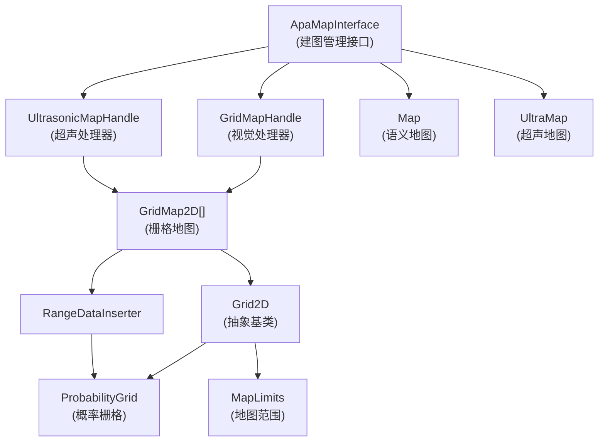
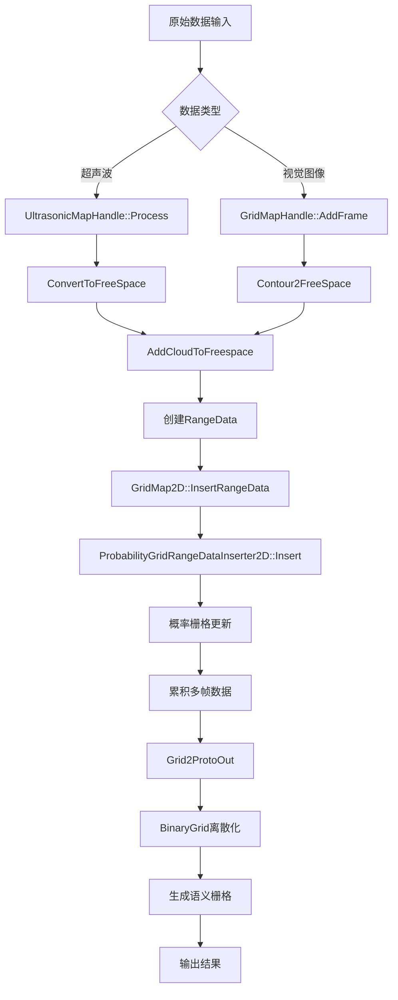
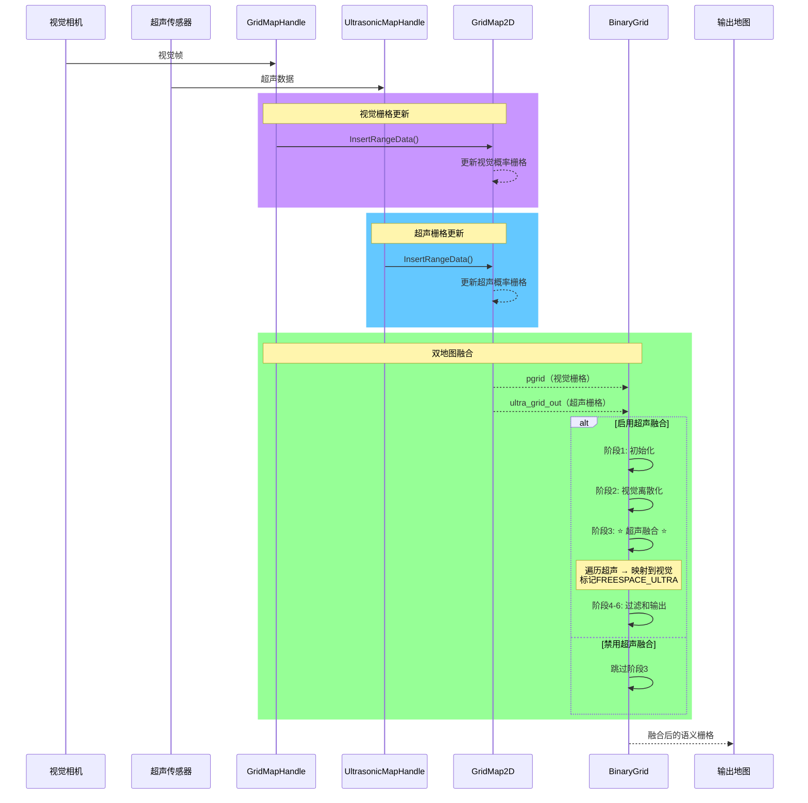
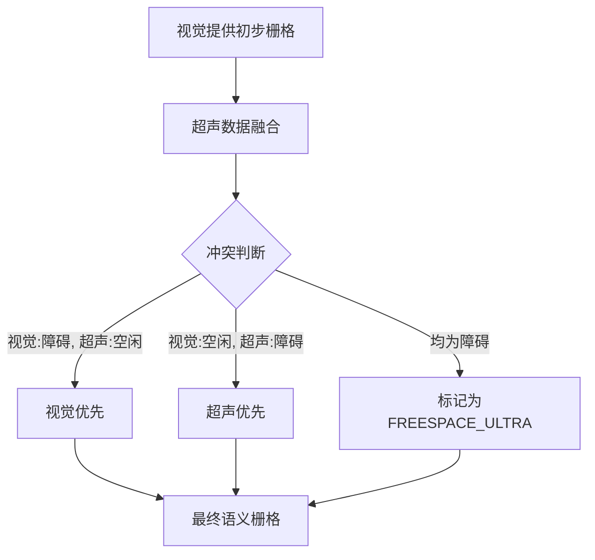
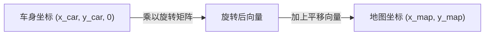
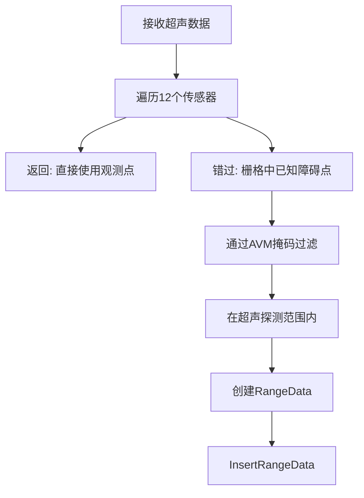
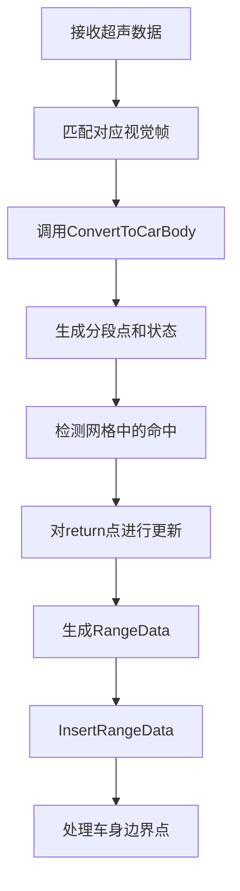
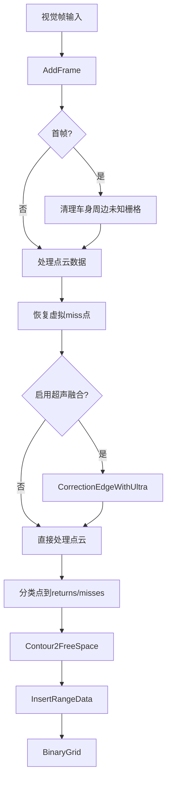

## 1 概述

本文档详细说明停车位检测系统的建图逻辑，包括从原始传感器数据到语义栅格地图输出的完整流程。系统采用超声波和视觉相机的数据融合方案，通过概率栅格地图存储环境信息，最后离散化为语义栅格供规划和决策使用。

## 1.5 系统类架构与数据流

### 1.5.1 核心类关系图

使用Mermaid图表展示：



### 1.5.2 ApaMapInterface 的角色

**位置**：apa_map_interface.h

ApaMapInterface是整个建图系统的核心管理接口，负责：

1. **多源数据融合**
   - 接收视觉帧：通过AddImage/AddFrame
   - 接收超声数据：通过AddUltrasonic
   - 管理帧缓冲和超声缓冲

2. **处理器协调**
   - 包含GridMapHandle实例（视觉处理）
   - 包含UltrasonicMapHandle实例（超声处理）
   - 管理两个处理器的生命周期

3. **地图输出**
   - 维护Map实例（视觉栅格）
   - 维护UltraMap实例（超声栅格）
   - 提供GetGrid接口获取最终栅格

4. **状态管理**
   - 车辆位姿：car_rot_, car_t_
   - 工作模式：work_mode_
   - 会话ID：session_id_

### 1.5.3 GridMap2D 与 GridMapHandle 的关系

**GridMapHandle** 的成员：
```cpp
std::vector<std::shared_ptr<mapping::GridMap2D>> grid_map_;  // 可能多层
```

**数据流**：
```
视觉帧
  ↓
GridMapHandle::AddFrame()
  ├─ 解析FreespaceFrame
  ├─ 调用Contour2FreeSpace()
  │   └─ AddPtsToGrid()转换为RangeData
  │
  └─ GridMap2D[0]::InsertRangeData()
      ├─ ProbabilityGridRangeDataInserter2D::Insert()
      │   └─ CastRays()更新概率栅格
      │
      └─ Grid2D::FinishUpdate()完成本轮更新
```

**GridMap2D的作用**：
- 包装Grid2D（实际为ProbabilityGrid）
- 管理RangeDataInserter
- 提供InsertRangeData统一接口
- 处理栅格裁剪和扩展

### 1.5.4 Grid2D、MapLimits 与 ProbabilityGrid 的关系

**Grid2D**：抽象基类
- 定义栅格操作接口
- 持有MapLimits（地图范围）
- 管理栅格数据（correspondence_cost_cells_）

**MapLimits**：地图范围定义
```cpp
class MapLimits {
    double resolution_;      // 0.1m
    Eigen::Vector2d max_;    // 地图最大坐标
    CellLimits cell_limits_; // 栅格维度
};
```

**坐标计算公式**：
$$cell\_index = \frac{max\_x - world\_x}{resolution} \times num\_x\_cells + \frac{max\_y - world\_y}{resolution}$$

**ProbabilityGrid**：Grid2D的具体实现
```cpp
class ProbabilityGrid : public Grid2D {
    ValueConversionTables* conversion_tables_;  // 概率转换表

    void SetProbability(...);  // 设置单个栅格概率
    float GetProbability(...); // 获取单个栅格概率
    std::unique_ptr<Grid2D> ComputeCroppedGrid() const override;
};
```

### 1.5.5 UltrasonicMapHandle 与超声栅格

**UltrasonicMapHandle** 的角色：
- 从超声传感器数据构建独立的栅格地图
- 同样使用GridMap2D管理（多层结构）
- 包含两种处理模式（cx835直插 vs 标准分段）

**超声与视觉的融合流程**：
```
超声栅格（grid_out_）
  ↓
视觉BinaryGrid()
  ├─ 离散化视觉概率栅格
  ├─ 读取超声known_cells_box
  └─ 将超声障碍映射为FREESPACE_ULTRA
     （标记区域、覆盖规则）
  ↓
最终语义栅格
```

### 1.5.6 实际应用示例

**ApaMapInterface的使用**：
```cpp
// 初始化
auto map_interface = std::make_shared<ApaMapInterface>();
map_interface->Init(config);

// 处理视觉帧
std::shared_ptr<mapping::FreespaceFrame> frame;
map_interface->AddFrame(frame);

// 处理超声数据
std::shared_ptr<mapping::UltrasonicData> ultra;
map_interface->AddUltrasonic(ultra);

// 获取地图
mapping::proto::Grid2D grid = map_interface->GetGrid();

// 查询栅格状态
int cell_value = grid.cells(index);
if (cell_value > threshold) {
    // 障碍物
}
```

**多个GridMap2D层的意义**：
- grid_map_[0]：主栅格（频繁更新）
- grid_map_[1]（可选）：备份栅格或其他用途
- 可通过索引切换不同分辨率或策略

### 1.5.7 类关系矩阵

| 类名 | 继承 | 包含 | 被包含 | 作用 |
|-----|------|------|--------|------|
| ApaMapInterface | MapInterface | GridMapHandle, UltrasonicMapHandle, Map, UltraMap | 上层应用 | 建图管理 |
| GridMapHandle | - | GridMap2D[], FreespaceFrame队列 | ApaMapInterface | 视觉处理 |
| UltrasonicMapHandle | - | GridMap2D[], UltrasonicData队列 | ApaMapInterface | 超声处理 |
| GridMap2D | - | Grid2D, RangeDataInserter | GridMapHandle, UltrasonicMapHandle | 地图层管理 |
| Grid2D | 抽象基类 | MapLimits, 栅格数据 | GridMap2D | 栅格接口 |
| ProbabilityGrid | Grid2D | ValueConversionTables | GridMap2D | 概率栅格 |
| MapLimits | - | - | Grid2D | 范围定义 |
| RangeData | - | origin, returns, misses | RangeDataInserter | 传感数据 |

---

## 2 整体建图流程



## 时序图



---

### 2.1 数据输入阶段

**超声波数据源：**
- 来自12个超声波传感器，通过`UltrasonicData`结构体传入
- 包含原始距离值、时间戳、车身位姿（旋转+平移）
- 在车身坐标系下表达，z轴固定为0

**视觉数据源：**
- 前后两个摄像头提供地面点云`FreespaceFrame::ground_points`
- 点云已分类为：路面、车辆、路沿等语义类别
- 已转换到车身坐标系，z轴固定为0

### 2.2 坐标变换阶段

所有数据经过统一的坐标变换管道：

$$\text{世界坐标} = \text{旋转矩阵} \cdot \text{车身坐标} + \text{平移向量}$$

**关键变换过程：**
1. 原始数据（车身坐标）→ 地图坐标
2. 使用`mapping::transform::Rigid3f`刚体变换
3. 俯仰角和横滚角置零，仅保留航向角（2D映射）

### 2.3 RangeData生成

`RangeData`结构体包含：
- `returns`: 命中点集合（检测到的障碍）
- `misses`: 未命中点集合（自由空间）
- `origin`: 传感器原点（地图坐标）

**超声波模式：**
- returns: 超声观测的距离点
- misses: 射线路径上的自由空间点

**视觉模式：**
- returns: 车辆、路沿等障碍点
- misses: 路面点（自由通行）

### 2.4 栅格更新阶段

通过`ProbabilityGridRangeDataInserter2D::Insert`执行：

1. **射线投射（CastRays）：** 从传感器原点到每个点投射射线
2. **概率更新：**
   - return点提升概率（hit_table_）
   - miss点降低概率（miss_table_）
3. **冲突处理：** hits优先级高于misses

### 2.5 离散化阶段

`BinaryGrid`函数将概率值离散化为语义标签：

- **FREESPACE_UNKOWN (1)：** 未知区域，概率值为0
- **FREESPACE_OBSTACLE (3)：** 障碍物，概率> 80%
- **FREESPACE_FEREESPACE (0)：** 自由空间，概率< 80%
- **FREESPACE_CURB (2)：** 路沿边界
- **FREESPACE_CAR (4)：** 车辆目标
- **FREESPACE_ULTRA (5)：** 超声融合障碍

### 2.6 数据融合阶段

**超声与视觉融合策略：**



## 3 关键数据结构详解

### 3.1 RangeData

```cpp
struct RangeData {
    std::vector<RangefinderPoint> returns;  // 命中点集合
    std::vector<RangefinderPoint> misses;   // 未命中点集合
    Eigen::Vector3f origin;                 // 传感器原点
};
```

**RangefinderPoint：**
```cpp
struct RangefinderPoint {
    Eigen::Vector3f position;  // 点的3D坐标
};
```

### 3.2 ProbabilityGrid

概率栅格使用对数概率存储，范围[0, 32767]：
- 0: 完全空闲（概率接近0）
- 16384: 中立（概率=0.5）
- 32767: 完全占用（概率接近1）

**离散化阈值：**
- 未知：值 == 0
- 障碍：0 < 值 < 32767 * 0.4
- 可行驶：值 >= 32767 * 0.4

### 3.3 MapLimits

```cpp
class MapLimits {
    double resolution_;  // 栅格分辨率，默认0.1m
    Eigen::Vector2d max_;  // 地图最大坐标
    CellLimits cell_limits_;  // 栅格维度
};
```

**栅格索引计算：**
```cpp
int cell_x = (max_x - world_x) / resolution;
int cell_y = (max_y - world_y) / resolution;
int linear_index = cell_x * num_x_cells + cell_y;
```

## 4 坐标系详细说明

### 4.1 坐标系定义

**车身坐标系（Body Frame）：**
- 原点：车辆中心
- X轴：车辆前向
- Y轴：车辆左向
- Z轴：竖直向上（建图忽略）

**地图坐标系（Map Frame）：**
- 原点：地图中心或初始位置
- X轴：全局X方向
- Y轴：全局Y方向
- Z轴：竖直向上

### 4.2 坐标变换矩阵



**变换公式：**
$$\begin{bmatrix} x_{map} \\ y_{map} \end{bmatrix} = \begin{bmatrix} \cos\theta & -\sin\theta \\ \sin\theta & \cos\theta \end{bmatrix} \begin{bmatrix} x_{car} \\ y_{car} \end{bmatrix} + \begin{bmatrix} t_x \\ t_y \end{bmatrix}$$

其中$\theta$为航向角，$(t_x, t_y)$为平移向量。

### 4.3 AVM坐标系（仅超声）

AVM (Around-View Monitor) 是环视坐标系，用于将车身坐标映射到2D掩码：

```cpp
// 车身坐标到AVM坐标的映射
Utility::RemapFromCarToAvmFrame(pos_car_x, pos_car_y, pos_avm);
// 再乘以掩码尺寸得到像素坐标
int avm_col = pos_avm[1] * mask.cols;
int avm_row = pos_avm[0] * mask.cols;
```

## 5 超声波建图详细流程

### 5.1 cx835模式（直插模式）



**代码实现：**

```cpp
// 步骤1: 将观测点添加为returns
for (int i = 0; i < data->obs_pts_.size(); ++i) {
    auto p = data->obs_pts_[i].start_p;  // 车身坐标
    RangefinderPoint tmp;
    tmp.position = Eigen::Vector3f(p.x, p.y, 0);
    rd.returns.push_back(tmp);
}

// 步骤2: 计算地图到车身的逆变换
Eigen::Matrix3d R = data->R_.toRotationMatrix().inverse();
Eigen::Vector3d t = -R * data->t_;

// 步骤3: 遍历栅格障碍点
for (auto pcv : gridmap_obs_pts_) {
    Eigen::Vector3d p(pcv.x, pcv.y, pcv.z);  // 世界坐标
    Eigen::Vector3d pos_car = R * p - t;      // 转到车身坐标

    // 步骤4: 映射到AVM坐标
    Eigen::Vector2d pos_avm;
    Utility::RemapFromCarToAvmFrame(pos_car[0], pos_car[1], pos_avm);

    // 步骤5: 检查是否在超声范围内
    int avm_col = pos_avm[1] * UltrasonicData::mask.cols;
    int avm_row = pos_avm[0] * UltrasonicData::mask.cols;

    if (avm_col >= 0 && avm_col < mask.cols && avm_row >= 0 && avm_row < mask.cols) {
        int sensor_idx = UltrasonicData::mask.at<cv::Vec3b>(avm_col, avm_row)[0];
        // 步骤6: 该点作为misses添加
        if (sensor_idx >= 1 && sensor_idx <= 12 && raw_data[sensor_idx-1] > 3) {
            RangefinderPoint tmp;
            tmp.position = Eigen::Vector3f(pos_car.x(), pos_car.y(), 0);
            rd.misses.push_back(tmp);
        }
    }
}

// 步骤7: 更新栅格
rd.origin = transform.translation().cast<float>();
rd.misses = TransformPointCloud(rd.misses, transform);
grid_map->InsertRangeData(rd);
```

### 5.2 标准模式（分段模式）

标准模式结合视觉帧生成分段点，流程更复杂：



**关键处理步骤：**

```cpp
// 步骤1: 从视觉帧生成分段点
data->ConvertToCarBody(frame, segment_points, status, index_ultra);
// 返回: segment_points[12], status[12], index_ultra

// 步骤2: 对每个超声传感器处理
for (int j = 0; j < segment_points.size(); ++j) {
    RangeData rd;
    auto points = segment_points[j];      // 该传感器的分段点
    auto point_status = status[j];        // 点的状态: 0=return, 1=miss

    // 步骤3: 检测网格中的命中
    for (int i = 0; i < points.size(); ++i) {
        if (point_status[i] == 0) {  // 仅检查return点
            // 变换到地图坐标
            Eigen::Vector3f p_map = transform.rotation() * p1 + transform.translation();

            // 查询超声输出网格
            int grid_idx = CalculateGridIndex(p_map);
            if (grid[grid_idx] > 0 && grid[grid_idx] < 32767 * 0.8) {
                // 该栅格已有命中，标记为已更新
                point_status_update[i] = true;
            }
        }
    }

    // 步骤4: 将未更新的return改为miss
    if (is_update) {
        for (int i = 0; i < points.size(); ++i) {
            if (!point_status_update[i] && point_status[i] == 0) {
                point_status[i] = 1;  // 改为miss
            }
        }
    }

    // 步骤5: 生成RangeData并写入
    for (auto p : points) {
        RangefinderPoint tmp;
        tmp.position = Eigen::Vector3f(p.x, p.y, 0);
        if (point_status[i] == 1) {
            rd.misses.push_back(tmp);
        } else {
            rd.returns.push_back(tmp);
        }
    }

    // 计算传感器原点并写入
    Eigen::Vector3f sensor_pos = transform.rotation() * Eigen::Vector3f(ultra_x[j], ultra_y[j], 0);
    rd.origin = transform.translation() + sensor_pos;
    grid_map->InsertRangeData(rd);
}
```

## 6 视觉建图详细流程

### 6.1 数据流



### 6.2 点分类逻辑

```cpp
bool GridMapHandle::AddPtsToGrid(cv::Point3f& p, RangeData& rd, bool is_rear) {
    RangefinderPoint tmp_point;

    // 虚拟miss点
    if (p.z == PERCEP_VIRTUAL_MISS_TYPE) {
        tmp_point.position = ImageXY2Body(p.x, p.y);
        rd.misses.push_back(tmp_point);
        return true;
    }

    // 非路面点（障碍物）
    if (p.z != PERCEP_ROAD_TYPE) {
        tmp_point.position = ImageXY2Body(p.x, p.y);

        // 后相机的静态障碍物特殊处理
        if (is_rear && p.z >= CONE_BARREL_TYPE && (p.x < 0.32 || p.x > 0.68)) {
            rd.misses.push_back(tmp_point);  // 路沿、柱子等边界作为miss
        } else {
            rd.returns.push_back(tmp_point);  // 其他障碍作为return
        }
    } else {
        // 路面点统一为miss
        tmp_point.position = ImageXY2Body(p.x, p.y);
        rd.misses.push_back(tmp_point);
    }

    return true;
}
```

**点类型编码：**

| 常量 | 值 | 含义 |
|-----|-----|------|
| PERCEP_ROAD_TYPE | 0 | 路面，作为miss |
| PERCEP_CAR_TYPE | 1 | 车辆，作为return |
| PERCEP_CURB_TYPE | 4 | 路沿，作为return |
| CONE_BARREL_TYPE | ≥5 | 锥桶、柱子等 |
| PERCEP_VIRTUAL_MISS_TYPE | 100 | 虚拟miss |
| ULTRA_CAR_TYPE | 9 | 超声修正的车辆 |

## 7 离散化和超声融合

### 7.1 BinaryGrid离散化

```cpp
void GridMapHandle::BinaryGrid(...) {
    int limit_obt = 32767 * 0.4;  // 障碍判定阈值

    for (int row = box.min_x(); row <= box.max_x(); row++) {
        for (int col = box.min_y(); col <= box.max_y(); col++) {
            int idx = nx * col + row;
            auto& cell = cells->at(idx);

            // 步骤1: 阈值离散化
            if (cell < limit_obt && cell != 0) {
                cell = FREESPACE_OBSTACLE;  // 障碍
            } else if (cell == 0) {
                cell = FREESPACE_UNKOWN;   // 未知
            } else {
                cell = FREESPACE_FEREESPACE;  // 可行驶
            }

            // 步骤2: 视觉类型映射
            if (out_grid_type_ && col < grid_curb_.rows && row < grid_curb_.cols) {
                int curb_val = grid_curb_.at<cv::Vec3b>(col, row)[0];
                if (curb_val >= 1 && cell == FREESPACE_OBSTACLE) {
                    cell = FREESPACE_CURB;  // 路沿优先级高于普通障碍
                }
                int car_val = grid_curb_.at<cv::Vec3b>(col, row)[1];
                if (car_val >= 5 && cell == FREESPACE_OBSTACLE) {
                    cell = FREESPACE_CAR;  // 车辆优先级
                }
            }

            // 步骤3: 超声融合
            if (add_ultra &&超声栅格中该位置!=UNKOWN) {
                // 检查位置范围和有效性
                int percep_idx = 映射到感知栅格索引;
                if (super_cell == FREESPACE_OBSTACLE) {
                    cells->at(percep_idx) = FREESPACE_ULTRA;  // 超声确认的障碍
                }
            }
        }
    }
}
```

### 7.2 孤立点过滤

```cpp
// 检查每个不可行驶栅格是否孤立
for (int row = box.min_x(); row <= box.max_x(); row++) {
    for (int col = box.min_y(); col <= box.max_y(); col++) {
        if (cell != FREESPACE_FEREESPACE && cell != FREESPACE_ULTRA_CAR) {
            int neighbor_count = 0;

            // 检查8邻域
            for (int dy = -1; dy <= 1; dy++) {
                for (int dx = -1; dx <= 1; dx++) {
                    if (dx == 0 && dy == 0) continue;
                    int neighbor_idx = nx * (col+dx) + (row+dy);
                    if (cells->at(neighbor_idx) == FREESPACE_FEREESPACE) {
                        neighbor_count++;
                    }
                }
            }

            // 若邻居过少则标记为孤立
            if (neighbor_count < 配置阈值) {
                single_p_index.push_back(idx);
            }
        }
    }
}

// 将孤立点置为可行驶
for (auto idx : single_p_index) {
    cells->at(idx) = FREESPACE_FEREESPACE;
}
```

## 8 实际代码调用示例

### 8.1 完整的超声波建图调用

```cpp
// 主建图管理类
class MappingManager {
    UltrasonicMapHandle ultrasonic_handle_;
    GridMapHandle visual_handle_;

    void OnUltrasonicData(const UltrasonicData& data) {
        // 步骤1: 缓存数据
        ultrasonic_handle_.Add(data);

        // Process线程自动处理，流程如下：
        // Step 1: UltrasonicMapHandle::Process() 从缓冲取数据
        // Step 2: ConvertToFreeSpace(data) 构造变换和调度
        // Step 3: AddCloudToFreespace() 生成RangeData
        // Step 4: GridMap2D::InsertRangeData() 更新栅格
        // Step 5: ProbabilityGridRangeDataInserter2D::Insert() 执行射线投射和概率更新
    }

    void OnVisualFrame(const std::vector<std::vector<cv::Point3f>>& points,
                       const Eigen::Vector3d& pose,
                       const Eigen::Quaterniond& rotation,
                       double timestamp) {
        // 步骤1: 入队视觉帧
        visual_handle_.AddFrame(points, pose, rotation, timestamp);

        // AddFrame() 流程：
        // Step 1: 匹配超声帧 FindCorrespondUltra(timestamp)
        // Step 2: 构造车身到地图变换
        // Step 3: 首帧清理车身周边 清除未知栅格
        // Step 4: 恢复虚拟miss点
        // Step 5: 超声融合修正 CorrectionEdgeWithUltra()
        // Step 6: 分类点并写入RangeData AddPtsToGrid()
        // Step 7: 坐标变换和栅格更新 InsertRangeData()
    }

    void GetOutputGrid(mapping::proto::Grid2D& output) {
        // 获取最终语义栅格
        visual_handle_.Grid2ProtoOut(output);

        // Grid2ProtoOut() 流程：
        // Step 1: 读取内部概率栅格
        // Step 2: BinaryGrid离散化为语义标签
        // Step 3: 类型映射（curb, car等）
        // Step 4: 超声融合 标记FREESPACE_ULTRA
        // Step 5: 孤立点过滤
        // Step 6: 返回最终proto Grid2D
    }
};

// 使用示例
MappingManager mapper;

// 处理传感器数据流
while (true) {
    // 接收超声数据
    if (has_ultrasonic_data) {
        mapper.OnUltrasonicData(ultrasonic_frame);
    }

    // 接收视觉数据
    if (has_vision_data) {
        mapper.OnVisualFrame(ground_points, pose, rotation, timestamp);
    }

    // 定期输出栅格
    if (need_output) {
        mapping::proto::Grid2D output_grid;
        mapper.GetOutputGrid(output_grid);
        // 发送给规划模块
        SendToPlanner(output_grid);
    }
}
```

### 8.2 手动调用底层API

```cpp
// 直接操作超声地图句柄
{
    auto ultrasonic_data = std::make_shared<UltrasonicData>();
    // ... 填充超声数据 ...

    ultrasonic_handle_.Add(ultrasonic_data);  // 入队

    // 处理线程会自动调用以下链路：
    // ultrasonic_handle_.Process()
    //   → ConvertToFreeSpace()
    //     → AddCloudToFreespace()
    //       → grid_map_->InsertRangeData()
}

// 直接操作视觉地图句柄
{
    std::vector<std::vector<cv::Point3f>> points;  // 地面点
    Eigen::Vector3d pose;  // 车辆位置
    Eigen::Quaterniond rot;  // 车辆旋转
    double timestamp;  // 时间戳

    visual_handle_.AddFrame(points, pose, rot, timestamp);
    // 内部调用：
    //   → Contour2FreeSpace()
    //     → AddPtsToGrid() 为每个点分类
    //       → InsertRangeData() 写入栅格
}

// 输出语义栅格
{
    mapping::proto::Grid2D proto_grid;
    visual_handle_.Grid2ProtoOut(proto_grid);
    // 内部调用：
    //   → BinaryGrid() 离散化和融合
    //     → 生成最终语义标签
}
```

## 9 关键参数和阈值

### 9.1 栅格参数

| 参数 | 默认值 | 含义 |
|-----|--------|------|
| `resolution` | 0.1 m | 栅格分辨率 |
| `hit_probability` | 0.54 | 命中点的概率值 |
| `miss_probability` | 0.48 | 未命中点的概率值 |
| `min_probability` | 0.1 | 最小概率（下界） |
| `max_probability` | 0.9 | 最大概率（上界） |

### 9.2 离散化阈值

| 阈值 | 值 | 说明 |
|-----|-----|------|
| `UNKNOWN` | 0 | 未知栅格 |
| `OBSTACLE` | 32767×0.4 | 障碍判定 |
| `FREESPACE` | ≥32767×0.4 | 自由空间 |

### 9.3 超声参数

| 参数 | 默认值 | 含义 |
|-----|--------|------|
| `ULTRA_NUM` | 12 | 超声传感器数量 |
| `raw_data_threshold` | 3 cm | 原始距离阈值 |
| `mask_resolution` | 像素 | AVM掩码分辨率 |

### 9.4 视觉参数

| 参数 | 默认值 | 含义 |
|-----|--------|------|
| `skip_step` | 配置相关 | 图像采样步长 |
| `freespace_neighbor_count_filter` | 配置相关 | 孤立点邻域阈值 |
| `map_resize_distance` | 配置相关 | 地图裁剪距离 |

## 10 调试和优化建议

### 10.1 常见问题

**问题1：栅格更新缓慢**
- 检查`InsertRangeData`是否频繁失败
- 验证RangeData的origin是否正确
- 确保坐标变换矩阵准确

**问题2：超声融合效果差**
- 检查AVM掩码是否与超声布局匹配
- 验证时间戳对齐的准确性
- 检查`raw_data_threshold`是否设置合理

**问题3：孤立点过多**
- 调整`freespace_neighbor_count_filter`阈值
- 增加视觉和超声的融合权重
- 检查点云分类的准确性

### 10.2 性能优化

1. **栅格分辨率调整：** 更粗的分辨率(0.2m)可加速处理
2. **已知区域限制：** 仅处理`known_cells_box`内的栅格
3. **并发处理：** 独立线程处理超声，避免阻塞视觉

## 11 参考文档

- 超声波建图：`/home/chengzhuo/parking_1201/文档/超声波点获取与写入地图逻辑.md`
- 视觉建图：`/home/chengzhuo/parking_1201/文档/视觉栅格点获取与写入地图逻辑.md`
- 栅格更新：`src/core/mapping/grid/probability_grid_range_data_inserter_2d.cc`
- 地图管理：`src/core/mapping/grid/grid_map_2d.cc`
- 超声处理：`src/core/mapping/grid/ultrasonic_map_handle.cc`
- 视觉处理：`src/core/mapping/grid/grid_map_handle.cc`
