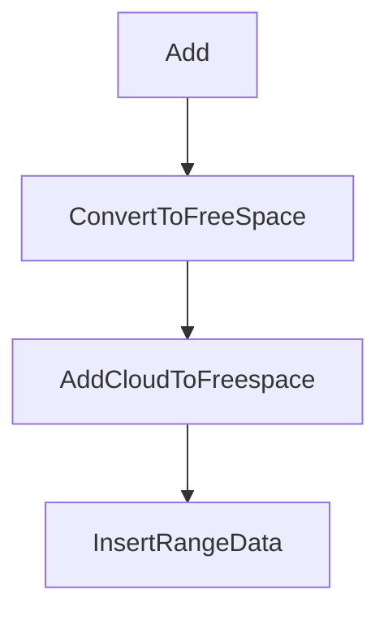
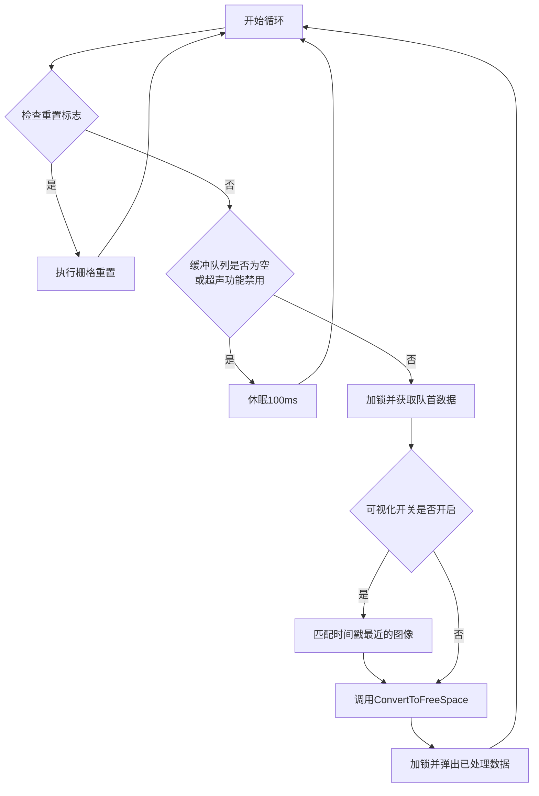
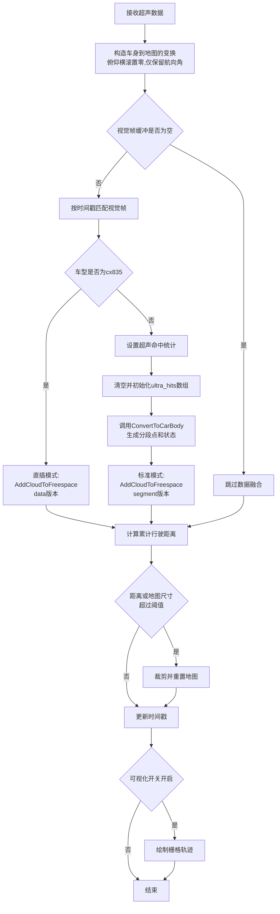
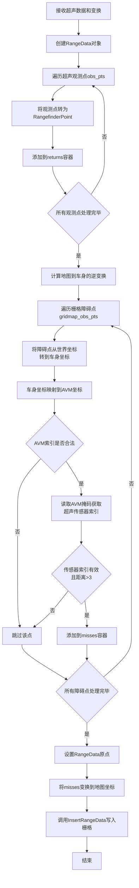

## 1 超声波点获取与写入地图逻辑

## 1.1 概览
- 超声波点来自 `UltrasonicData`，通过 `UltrasonicMapHandle::Add` 入队。
- 处理线程 `Process` 调用 `ConvertToFreeSpace` 生成 returns/misses。
- 写入地图统一走 `GridMap2D::InsertRangeData` 与 `ProbabilityGridRangeDataInserter2D::Insert`。
- 输出阶段 `Grid2ProtoOut` 通过 `BinaryGrid` 离散化并统计 `ultra_hits_`。

## 1.2 数据流与模块关系
- 超声点在车身坐标生成后再变换到地图坐标并更新栅格。



## 1.3 坐标系与单位
- 超声原始点以车身坐标系表达，z 固定为 0。
- `data->R_` 与 `data->t_` 构成 `Rigid3f`，用于转到地图坐标。
- 栅格分辨率默认 0.1 m，索引由 `MapLimits` 计算。
- `ultra_x_` `ultra_y_` 是单个传感器在车身坐标的位置。

## 1.4 关键类型与状态编码

| 字段 | 数值 | 用途 |
|---|---|---|
| `ULTRA_NUM` | 12 | 传感器数量 |
| `points_status=0` | 0 | 视为 return 点 |
| `points_status=1` | 1 | 视为 miss 点 |
| `FREESPACE_OBSTACLE` | 3 | BinaryGrid 障碍类型 |
| `FREESPACE_UNKOWN` | 1 | BinaryGrid 未知类型 |

## 1.5 关键函数速览

| 函数 | 位置 | 作用 |
|---|---|---|
| `UltrasonicMapHandle::Process` | `src/core/mapping/grid/ultrasonic_map_handle.cc` | 主处理循环 |
| `UltrasonicMapHandle::ConvertToFreeSpace` | `src/core/mapping/grid/ultrasonic_map_handle.cc` | 生成分段点与状态 |
| `UltrasonicMapHandle::AddCloudToFreespace` | `src/core/mapping/grid/ultrasonic_map_handle.cc` | 写入 returns/misses |
| `UltrasonicMapHandle::BinaryGrid` | `src/core/mapping/grid/ultrasonic_map_handle.cc` | 概率栅格离散化 |

## 1.6 处理流程概览
- `Process` 获取超声帧并触发 `ConvertToFreeSpace`。
- `ConvertToFreeSpace` 生成分段点与状态或走直插路径。
- `AddCloudToFreespace` 将点写入 `RangeData` 并更新栅格。
- `BinaryGrid` 将概率栅格离散化并统计 `ultra_hits_`。

## 1.7 重点函数逐行解释
### 1.7.1 UltrasonicMapHandle::Process

**功能描述：** 这是超声波建图的主处理线程入口函数。它持续运行在独立线程中，负责从缓冲队列中取出超声波数据帧，并调用 `ConvertToFreeSpace` 进行栅格更新。当缓冲队列为空或超声功能被禁用时，线程会休眠等待；当重置标志被置位时，会执行栅格重置操作。此函数还支持可视化模式，可以关联时间戳最近的图像数据用于调试显示。



#### 1.7.1.1 代码

```cpp
   287	void UltrasonicMapHandle::Process() {  // 超声处理线程入口
   288	  pthread_setname_np(pthread_self(), " UltrasonicMapHandle");  // 设置线程名称便于调试
   289	  while (thread_flag_) {  // 主循环，thread_flag_为true则持续运行
   290
    if (reset_flag_) {  // 检查是否收到重置信号
   291
      PerformResetGrid();  // 执行重置，清空所有建图数据
   292
      continue;  // 重置后继续下一轮循环
   293
    }
   294

   295
    if (ultrasonic_buffer_.empty() ||  // 检查缓冲队列是否为空
   296
        !utility::ConfigLoad::Instance()->Parser()->env_param_.add_ultra) {  // 或超声功能被禁用
   297
      std::this_thread::sleep_for(std::chrono::milliseconds(100));  // 无工作时休眠100ms节省CPU
   298
    } else {  // 有数据可处理且功能启用
   299
      {  // 栅格处理临界区开始
   300
        auto data = ultrasonic_buffer_.front();  // 获取队列首部数据（注意未弹出）
   301
        std::unique_lock<std::mutex> munique(ultrasonic_grid_m_);  // 加互斥锁保护栅格
   302
        if (munique.owns_lock() == false) {  // 验证锁是否成功获取
   303
          AINFO << "[" << __func__ << "], lock failed!\n";  // 锁失败日志
   304
          return;  // 严重错误，退出线程
   305
        }
   306

   307
        if (utility::ConfigLoad::Instance()  // 检查是否启用感知可视化
   308
                ->Parser()
   309
                ->env_param_.show_perception) {  // 配置标志
   310
          cv::Mat im;  // 临时存储匹配的图像
   311
          double im_t = 0;  // 存储匹配图像的时间戳
   312
          for (auto m : image_map_) {  // 遍历缓存的所有图像
   313
            if (fabs(m.first - data->timestamp_) < 0.1) {  // 查找时间戳差<100ms的图像
   314
              im = m.second;  // 获取该图像
   315
              im_t = m.first;  // 记录图像时间戳
   316
              break;  // 找到即刻停止
   317
            }
   318
          }
   319
          if (!im.empty()) {  // 确认找到有效图像
   320
            // data->image_ = im.clone();  // 可选：克隆图像到超声帧（已注释）
   321
            data->image_t_ = im_t;  // 将图像时间戳传入超声数据供可视化同步
   322
          }
   323
        }
   324
        // AINFO <<"Process, xx: "<<std::setprecision(15)<<data->timestamp_;  // 调试日志（已注释）
   325
        ConvertToFreeSpace(data);  // 调用核心处理函数处理超声数据
   326
        // std::cerr << __func__ << ", ultrasonic_buffer_ size is  // 调试日志（已注释）
   327
        // "<<ultrasonic_buffer_.size()<<std::endl;
   328
      }  // 栅格处理临界区结束，自动释放锁
   329

   330
      {  // 缓冲队列处理临界区开始
   331
        std::unique_lock<std::mutex> munique(ultrasonic_buffer_m_);  // 加锁保护缓冲队列
   332
        if (munique.owns_lock() == false) {  // 验证锁获取成功
   333
          AINFO << "[" << __func__ << "], lock failed!\n";  // 锁失败日志
   334
          return;  // 退出线程
   335
        }
   336
        ultrasonic_buffer_.pop();  // 弹出刚处理过的数据帧
   337
      }  // 缓冲队列临界区结束，自动释放锁
   338
    }
   339
  }  // 结束while主循环
   340
}  // 函数结束
```

### 1.7.2 UltrasonicMapHandle::ConvertToFreeSpace

**功能描述：** 这是超声波数据处理的核心调度函数。它负责将原始超声波数据转换为自由空间点云并写入栅格地图。函数首先构造从车身坐标系到地图坐标系的刚体变换，然后根据车型配置选择不同的处理路径：cx835车型走直插模式，其他车型需要结合视觉帧生成分段点。此外，函数还监控车辆累计行驶距离和地图尺寸，当超过阈值时触发地图裁剪以控制内存占用，最后更新时间戳并触发可视化。



#### 1.7.2.1 代码

```cpp
   436	void UltrasonicMapHandle::ConvertToFreeSpace(
   437	    const std::shared_ptr<UltrasonicData> data) {  // 输入超声数据帧的智能指针
   438	  Eigen::Quaternionf crot = data->R_.cast<float>();  // 将double精度四元数转为float
   439
  crot.x() = crot.y() = 0;  // 清零pitch和roll角，仅保留yaw用于2D投影
   440
  mapping::transform::Rigid3f transform(  // 构造3D刚体变换
   441
      Eigen::Vector3f(data->t_[0], data->t_[1], 0), crot);  // 平移取xy，z置0；旋转用修正后的四元数
   442

   443
  std::vector<std::vector<cv::Point2d>> segment_points;  // 外层传感器索引，内层各传感器的分段点
   444
  std::vector<std::vector<int>> status;  // 与segment_points对应，0表return命中, 1表miss
   445
  std::vector<int> index_ultra;  // 记录有效传感器索引
   446
  // AINFO<<__func__<<", in";  // 调试日志入口（已注释）
   447

   448
  if (!freespace_buffer_.empty()) {  // 检查视觉缓冲是否有帧可用于融合
   449
    auto frame = FindCorrespondFrame(data->timestamp_);  // 找时间戳最接近的视觉帧
   450
    // /*for debug*/  // 调试块开始（已注释）
   451
    // double frame_t = 0;  // 调试变量
   452
    // if (frame){  // 若成功匹配视觉帧
   453
    //   frame_t = frame->timestamp;  // 记录时间戳
   454
    // }
   455
    // AINFO <<", xx: "<<std::setprecision(15)<<data->timestamp_<<""  // 调试输出
   456
    // "<<frame_t<<" "<<data->t_[0]<<" "<<data->t_[1];
   457
    /*****************/  // 调试块结束
   458

   459
    if (utility::ConfigLoad::Instance()->Parser()->env_param_.type_ == "cx835") {  // 判断车型
   460
      AddCloudToFreespace(data, transform);  // cx835用直插模式
   461
    } else {  // 非cx835用标准模式
   462
      data->SetUltraStatus(ultra_hits_);  // 将上一帧的命中统计传入当前帧
   463
      ultra_hits_.resize(0);  // 清空命中计数数组
   464
      for (int i = 0; i < ULTRA_NUM; ++i) {  // 为12个传感器初始化
   465
        ultra_hits_.push_back(0);  // 每个传感器的命中计数初值为0
   466
      }
   467
      data->ConvertToCarBody(frame, segment_points, status, index_ultra);  // 生成分段点和状态
   468

   469
      AddCloudToFreespace(segment_points, status, index_ultra, data, transform);  // 标准模式处理
   470
    }
   471

   472
    // } else{  // 视觉缓冲为空的分支（已注释）
   473
    //   /*for debug*/
   474
    //   double frame_t = 0;
   475
    //   AINFO <<", freespace_buffer_ is empty "<<freespace_buffer_.size();
   476
    //   /*****************/
   477
  }
   478

   479
  static Eigen::Vector2d last_pose = data->t_.head(2);  // 记录上一帧位姿，初值为当前帧
   480
  static double distance = 0;  // 累计行驶距离静态变量
   481
  Eigen::Vector2d delta_dis = data->t_.head(2) - last_pose;  // 计算相邻帧间位移向量
   482
  distance += delta_dis.norm();  // 累加欧氏距离
   483
  last_pose = data->t_.head(2);  // 更新为当前帧位姿
   484
  double sizex = grid_map_[0]->grid()->limits().cell_limits().num_x_cells *  // 计算x方向物理尺寸
   485
                 grid_option_.resolution;  // 栅格数乘以分辨率
   486
  double sizey = grid_map_[0]->grid()->limits().cell_limits().num_y_cells *  // 计算y方向物理尺寸
   487
                 grid_option_.resolution;  // 栅格数乘以分辨率
   488
  if (distance >=  // 判断是否触发地图裁剪
   489
          utility::ConfigLoad::Instance()->Parser()->env_param_.map_size ||  // 条件1：累计距离超限
   490
      sizex > 35 || sizey > 35) {  // 条件2：地图尺寸超过35m
   491
    AINFO << __func__ << " crop distance: " << distance << std::endl;  // 记录裁剪信息
   492
    ResizeGrid(data->t_);  // 以当前位姿为中心重新划定地图范围
   493
    distance = 0;  // 重置距离计数器
   494
  }
   495

   496
  timestamp_ = data->timestamp_;  // 更新成员变量时间戳
   497
  if (utility::ConfigLoad::Instance()->Parser()->env_param_.show_perception) {  // 检查可视化开关
   498
    GridMapVisual(grid_map_[0]->grid(), data->t_[0], data->t_[1]);  // 绘制栅格和轨迹
   499
  }
   500
}  // 函数结束
```

### 1.7.3 UltrasonicMapHandle::AddCloudToFreespace (cx835直插模式)

**功能描述：** 这是cx835车型专用的直插模式处理函数。它直接将超声观测点作为returns写入，同时将栅格地图中已标记为障碍的点反投影到车身坐标系，通过AVM掩码判断是否在超声探测范围内，满足条件的点作为misses写入，实现超声与地图的双向验证，提高建图准确性。



#### 1.7.3.1 代码

```cpp
   502	void UltrasonicMapHandle::AddCloudToFreespace(
   503	    const std::shared_ptr<UltrasonicData> data,  // cx835模式超声数据帧
   504
    const mapping::transform::Rigid3f& transform) {  // 车身到地图变换
   505
  mapping::sensor::RangeData rd;  // 创建RangeData容器存储returns和misses
   506
  for (int i = 0; i < (int)data->obs_pts_.size(); ++i) {  // 遍历所有观测点
   507
    auto p = data->obs_pts_[i].start_p;  // 获取第i个观测点坐标（车身坐标）
   508
    mapping::sensor::RangefinderPoint tmp;  // 创建测距点
   509
    tmp.position = Eigen::Vector3f(p.x, p.y, 0);  // 设置点坐标，z轴恒为0
   510
    rd.returns.push_back(tmp);  // 加入returns容器表示障碍点
   511
  }
   512

   513
  Eigen::Matrix3d R = data->R_.toRotationMatrix().inverse();  // 计算旋转矩阵的逆
   514
  Eigen::Vector3d t = -R * data->t_;  // 计算逆平移向量：-R^-1 * t
   515
  for (auto pcv : gridmap_obs_pts_) {  // 遍历栅格中已知障碍点
   516
    Eigen::Vector3d p(pcv.x,pcv.y,pcv.z);  // 构造世界坐标点向量
   517
    Eigen::Vector3d pos_car = R * p - t;  // 逆变换到车身坐标
   518
    Eigen::Vector2d pos_avm;  // 创建AVM坐标变量
   519
    Utility::RemapFromCarToAvmFrame(pos_car[0], pos_car[1], pos_avm);  // 映射到AVM坐标
   520
    int avm_col = pos_avm[1] * UltrasonicData::mask.cols;  // 计算AVM列索引
   521
    int avm_row = pos_avm[0] * UltrasonicData::mask.cols;  // 计算AVM行索引
   522

   523
    if (avm_col >= 0 && avm_col < UltrasonicData::mask.cols && avm_row >= 0 &&  // 检查行列索引
   524
        avm_row < UltrasonicData::mask.cols) {  // 都在有效范围
   525
      int index = UltrasonicData::mask.at<cv::Vec3b>(avm_col, avm_row)[0];  // 读掩码获取传感器索引
   526
      if (index >= 1 && index <= ULTRA_NUM && data->raw_data_[index-1] > 3) {  // 验证索引和距离有效
   527
        mapping::sensor::RangefinderPoint tmp;  // 创建测距点
   528
        tmp.position = Eigen::Vector3f(pos_car.x(), pos_car.y(), 0);  // 设置车身坐标
   529
        rd.misses.push_back(tmp);  // 加入misses表示已知障碍区
   530
      }
   531
    }
   532
  }
   533

   534
  rd.origin = transform.translation().cast<float>();  // 设置RangeData原点为车身位置
   535
  rd.misses = mapping::sensor::TransformPointCloud(rd.misses, transform);  // 变换misses到地图坐标
   536
  auto& grid_map = grid_map_[0];  // 获取主栅格
   537
  grid_map->InsertRangeData(rd);  // 写入栅格更新
   538

   539
}
```

### 1.7.4 UltrasonicMapHandle::AddCloudToFreespace (标准分段模式)

**功能描述：** 这是标准模式的分段处理函数，与cx835直插模式相比，它首先检测分段的return点是否已在超声输出网格中存在（即检查该点是否已经被超声观测证实），若存在则保留return状态，否则改为miss状态以表示未被确认。这种双向验证机制提高了建图的一致性和可靠性。

#### 1.7.4.1 代码

```cpp
   541	void UltrasonicMapHandle::AddCloudToFreespace(
   542
    std::vector<std::vector<cv::Point2d>>& segment_points,  // 分段点，外层12传感器，内层各点序列
   543
    std::vector<std::vector<int>>& status,  // 点状态，0=return命中, 1=miss
   544
    std::vector<int>& index_ultra,  // 传感器索引容器
   545
    const std::shared_ptr<UltrasonicData>& data,  // 超声数据帧
   546
    const mapping::transform::Rigid3f& transform) {  // 车身到地图变换
   547
  for (int j = 0; j < (int)segment_points.size(); ++j) {  // 遍历12个传感器
   548
    mapping::sensor::RangeData rd;  // 为该传感器创建RangeData
   549
    auto segment_point_ultra = segment_points[j];  // 获取传感器j的分段点序列
   550
    auto points_status = status[j];  // 获取该传感器的点状态序列
   551
    double x_car = (data->ultra_x_[j]);  // 获取传感器j的车身坐标x
   552
    double y_car = data->ultra_y_[j];  // 获取传感器j的车身坐标y
   553

   554
    /* 检测超声输出网格中是否存在命中 */
   555
    double ultra_mx = grid_out_.limits().max().x(),  // 超声网格最大x
   556
           ultra_my = grid_out_.limits().max().y();  // 超声网格最大y
   557
    auto ultra_resolution = grid_out_.limits().resolution();  // 网格分辨率
   558
    int ultra_nx = grid_out_.limits().cell_limits().num_x_cells();  // x方向栅格数
   559
    auto cells = grid_out_.mutable_cells();  // 获取网格数据指针
   560
    std::vector<bool> point_status_update(segment_point_ultra.size(), false);  // 跟踪各点是否被更新
   561
    bool is_update = false;  // 该传感器是否有任何点被更新
   562
    // double x_car = (UltrasonicData::ultra_x_[j]);  // 备用代码（已注释）
   563
    // double y_car = UltrasonicData::ultra_y_[j];  // 备用代码（已注释）
   564
    for (int i = 0; i < (int)segment_point_ultra.size(); ++i) {  // 遍历该传感器的所有分段点
   565
      if (points_status[i] == 0) {  // 仅检查return点
   566
        Eigen::Vector3f p1, p2;  // p1车身坐标, p2地图坐标
   567
        cv::Point2d temp_p = segment_point_ultra[i];  // 获取第i个分段点
   568
        p1[0] = temp_p.x;  // 赋值x坐标
   569
        p1[1] = temp_p.y;  // 赋值y坐标
   570
        p1[2] = 0;  // z轴固定为0
   571
        p2 = transform.rotation() * p1 + transform.translation().cast<float>();  // 变换到地图坐标
   572

   573
        /* 计算地图坐标对应的网格索引 */
   574
        int ultra_h = (ultra_mx - p2[0]) / ultra_resolution;  // 行索引
   575
        int ultra_w = (ultra_my - p2[1]) / ultra_resolution;  // 列索引
   576
        int ultra_i = ultra_h * ultra_nx + ultra_w;  // 线性索引
   577
        if (ultra_i >= cells->size() || ultra_i < 0) continue;  // 索引越界跳过
   578
        if (cells->at(ultra_i) > 0 && cells->at(ultra_i) < 32767 * 0.8) {  // 网格值在强度范围内
   579
          point_status_update[i] = true;  // 标记该点已更新
   580
          is_update = true;  // 设置该传感器的更新标志
   581
        }
   582
      }
   583
    }
   584

   585
    if (is_update) {  // 若该传感器有任何点被更新
   586
      for (int i = 0; i < (int)segment_point_ultra.size(); ++i) {  // 再次遍历所有点
   587
        if (!point_status_update[i] && points_status[i] == 0)  // 未被更新且为return点
   588
          points_status[i] = 1;  // 改为miss点
   589
      }
   590
    }
   591
    /****** 网格检测阶段结束 ******/
   592

   593
    for (int i = 0; i < (int)segment_point_ultra.size(); ++i) {  // 根据状态分类点
   594
      cv::Point2d& p1 = segment_point_ultra[i];  // 获取点坐标
   595
      if (points_status[i] == 1) {  // miss点
   596
        mapping::sensor::RangefinderPoint tmp;
   597
        tmp.position = Eigen::Vector3f(p1.x, p1.y, 0);  // 设置坐标
   598
        rd.misses.push_back(tmp);  // 加入misses
   599
      } else if (points_status[i] == 0) {  // return点
   600
        mapping::sensor::RangefinderPoint tmp;
   601
        tmp.position = Eigen::Vector3f(p1.x, p1.y, 0);  // 设置坐标
   602
        rd.returns.push_back(tmp);  // 加入returns
   603
      }
   604
    }
   605

   606
    Eigen::Vector3f ultra_position = Eigen::Vector3f(x_car, y_car, 0);  // 传感器车身坐标
   607
    Eigen::Vector3f ultra_pos = transform.rotation() * ultra_position;  // 变换旋转部分
   608
    rd.origin = transform.translation().cast<float>() + ultra_pos;  // 计算地图坐标中的原点
   609
    rd.origin.z() = 0;  // z强制为0
   610
    rd.returns = mapping::sensor::TransformPointCloud(rd.returns, transform);  // 变换returns
   611
    rd.misses = mapping::sensor::TransformPointCloud(rd.misses, transform);  // 变换misses
   612
    auto& grid_map = grid_map_[0];  // 获取主栅格
   613
    if(!grid_map->InsertRangeData(rd)){  // 插入数据到栅格
   614
      AINFO << "ultra grid Insert ground point Fail!";  // 插入失败日志
   615
      reset_flag_ = true;  // 标记需要重置
   616
      return;  // 返回
   617
    }
   618
    // AINFO << __func__ <<", "<<rd.returns.size()<<", "<<rd.misses.size();  // 调试（已注释）
   619
  }
   620

   621
  /* 处理车身边界点 */
   622
  mapping::sensor::RangeData rd;  // 创建新的RangeData用于车边界
   623
  for (auto p : car_edge_pts_) {  // 遍历所有车边界点
   624
    mapping::sensor::RangefinderPoint tmp_point;  // 创建测距点
   625
    tmp_point.position =
   626
        Eigen::Vector3f(p.x, p.y, 0);  // 设置点坐标，z为0
   627
    rd.misses.push_back(tmp_point);  // 车边界点作为misses
   628
  }
   629
  rd.origin = transform.translation().cast<float>();  // 设置原点为车身位置
   630
  // AINFO<< __func__ << ",i: "<<i<<", "<<  transform.translation()[0]<<",  // 调试（已注释）
   631
  // "<<transform.translation()[1]<<", "<<camera_pos[0]<<", "<<camera_pos[1];
   632
  // rd.returns = mapping::sensor::TransformPointCloud(rd.returns, transform);  // 注释
   633
  rd.misses = mapping::sensor::TransformPointCloud(rd.misses, transform);  // 变换到地图坐标
   634
  auto& grid_map = grid_map_[0];  // 获取主栅格
   635
  if(!grid_map->InsertRangeData(rd)){  // 插入边界点
   636
    AINFO << "ultra grid Insert ground point Fail!";  // 失败日志
   637
    reset_flag_ = true;  // 标记重置
   638
    return;  // 返回
   639
  }
   640
}
```

### 1.7.5 UltrasonicMapHandle::BinaryGrid

**功能描述：** 将超声概率栅格离散化为语义栅格，并统计每个传感器的命中次数。函数遍历已知区域内的所有栅格，根据概率值进行阈值判断（低概率为可行驶，中等概率为障碍），然后通过AVM掩码获取对应的超声传感器索引，最后统计该传感器的命中计数。

#### 1.7.5.1 代码

```cpp
   198	void UltrasonicMapHandle::BinaryGrid(mapping::proto::Grid2D& pgrid,  // 输入概率栅格
   199
                                     const bool& free_flag) {  // 模式标志
   200
  // 原始自由空间的离散阈值
   201
  int limit_free = 32767 * 0.35;  // 自由空间阈值
   202
  // 轮廓模式的离散阈值
   203
  int limit_obt = 32767 * 0.4;  // 障碍判定阈值
   204
  // static int limit_max = 32767*0.9;  // 最大阈值（未使用）
   205
  auto cells = pgrid.mutable_cells();  // 获取可修改的栅格数据
   206
  size_t count = 0;  // 计数器，统计障碍栅格数
   207
  auto box = pgrid.known_cells_box();  // 获取已知栅格范围
   208
  int nx = pgrid.limits().cell_limits().num_x_cells();  // x方向栅格总数
   209
  auto resolution = pgrid.limits().resolution();  // 栅格分辨率
   210
  double mx = pgrid.limits().max().x(), my = pgrid.limits().max().y();  // 最大坐标
   211
  // for( auto &cell:*cells){  // 备用遍历方式（未使用）
   212

   213
  gridmap_obs_pts_.clear();  // 清空障碍点容器，准备更新
   214
  for (int row = box.min_x(); row <= box.max_x(); row++) {  // 遍历行
   215
    for (int col = box.min_y(); col <= box.max_y(); col++) {  // 遍历列
   216
      int i = nx * col + row;  // 计算线性索引
   217
      auto& cell = cells->at(i);  // 获取该栅格值引用
   218
      if (free_flag)  // 模式判断
   219
        cell = (cell < limit_free && cell > 0) ? 0 : 1;  // 自由空间模式离散化
   220
      else {  // 轮廓模式
   221
        //   cell = (cell==0||cell<limit_obt)?1:0;  // 备用逻辑（已注释）
   222
        if (cell == 0) {  // 完全未知
   223
          cell = FREESPACE_UNKOWN;  // 标记为未知
   224
          continue;  // 跳过此栅格
   225
        }
   226
        /* 根据阈值离散化 */
   227
        cell = (cell > 0 && cell < limit_obt) ? FREESPACE_OBSTACLE  // 障碍
   228
                                              : FREESPACE_FEREESPACE;  // 可行驶
   229
        if (cell == FREESPACE_OBSTACLE) {  // 若判定为障碍
   230
          int h = i / nx;  // 计算行号
   231
          int w = i % nx;  // 计算列号
   232
          double x = mx - h * resolution;  // 计算世界坐标x
   233
          double y = my - w * resolution;  // 计算世界坐标y
   234
          Eigen::Vector3d pos_w;  // 创建世界坐标向量
   235
          pos_w << x, y, 0;  // 赋值坐标
   236
          cv::Point3d pw(x, y, 0);  // 创建cv点
   237
          gridmap_obs_pts_.push_back(pw);  // 加入障碍点容器
   238
          Eigen::Vector3d pos_car =
   239
              car_rot_.inverse() * pos_w - car_rot_.inverse() * car_t_;  // 变换到车身坐标
   240
          Eigen::Vector2d pos_avm;  // 创建AVM坐标
   241
          Utility::RemapFromCarToAvmFrame(pos_car[0], pos_car[1], pos_avm);  // 映射到AVM坐标
   242
          int avm_col = pos_avm[1] * UltrasonicData::mask.cols;  // 计算AVM列索引
   243
          int avm_row = pos_avm[0] * UltrasonicData::mask.cols;  // 计算AVM行索引
   244
          /*for debug*/  // 调试块开始
   245
          // if (x <-2 && x > -7 && y < -2 && y > -5) {  // 条件性输出（已注释）
   246
          //   AINFO <<__func__<<", p_w:("<<x<<", "<<y<<"),
   247
          //   p_c:("<<pos_car[0]<<", "<<pos_car[1]<<"), p_a:("<<avm_col<<",
   248
          //   "<<avm_row<<")";
   249
          // }
   250
          /********************/  // 调试块结束
   251
          if (avm_col >= 0 && avm_col < UltrasonicData::mask.cols &&  // 检查列索引
   252
              avm_row >= 0 && avm_row < UltrasonicData::mask.cols) {  // 检查行索引
   253
            int index = UltrasonicData::mask.at<cv::Vec3b>(avm_col, avm_row)[0];  // 读掩码获取传感器
   254
            if (index >= 1 && index <= ULTRA_NUM) {  // 验证传感器索引有效
   255
              ultra_hits_[index - 1]++;  // 该传感器命中计数加1
   256
            }
   257
          }
   258
        }
   259
      }
   260
      if (cell == FREESPACE_OBSTACLE) count++;  // 统计障碍栅格
   261
    }
   262
  }
   263
  // AINFO << "zero cell num / total num: " << count << " / " << cells->size();  // 调试输出（已注释）
   264
}
```

## 1.8 与视觉栅格联动
- `GridMapHandle::AddUltrasonic` 将超声帧缓存用于视觉修正。
- `GridMapHandle::FindCorrespondUltra` 按时间戳匹配最邻近超声帧。
- `CorrectionEdgeWithUltra` 按超声覆盖区域分组视觉点并修正位置。
- 修正点以 `ULTRA_CAR_TYPE` 进入视觉栅格更新链路。

## 1.9 关键参数与阈值

| 参数 | 来源 | 含义 |
|---|---|---|
| `grid_option_.resolution` | 代码 | 超声栅格分辨率 0.1 m |
| `hit_probability` | 代码 | 命中概率 0.54 |
| `miss_probability` | 代码 | 未命中概率 0.48 |
| `limit_obt=0.4*32767` | 常量 | 障碍判定阈值 |

## 1.10 边界条件与注意事项
- `env_param_.add_ultra` 为 false 时处理线程不更新。
- `ultrasonic_buffer_` 在部分车型限制为 10 帧。
- `ResizeGrid` 由行驶距离与地图尺寸共同触发。
- `AddCloudToFreespace` 写入失败会触发 `reset_flag_`。
- `BinaryGrid` 仅处理 `known_cells_box` 内的栅格。

## 1.11 参考与版本信息
- 超声主逻辑：`src/core/mapping/grid/ultrasonic_map_handle.cc`
- 超声接口：`src/core/mapping/grid/ultrasonic_map_handle.h`
- 超声数据结构：`src/core/interfaces/mapping/ultrasonic_data.h`
- 栅格更新：`src/core/mapping/grid/probability_grid_range_data_inserter_2d.cc`
