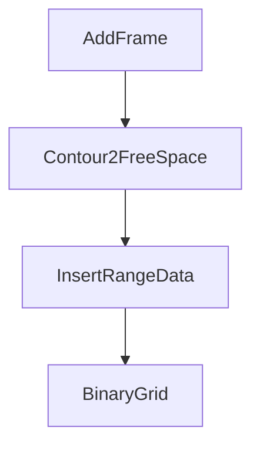
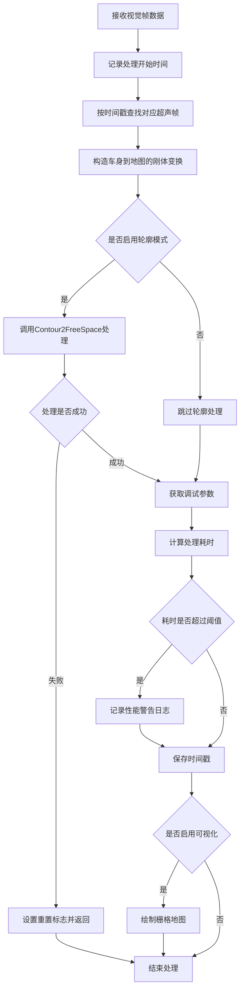
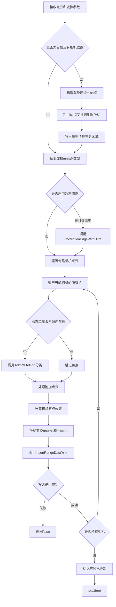
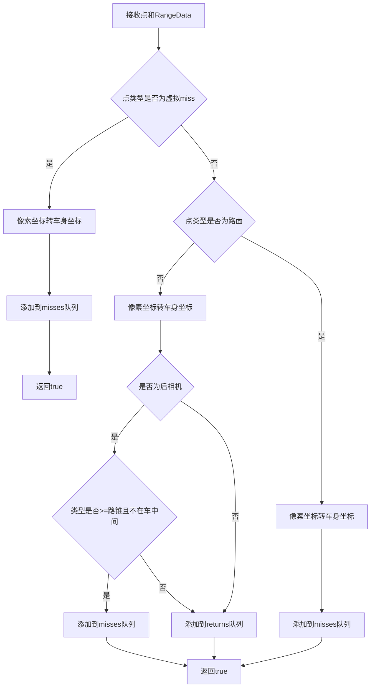
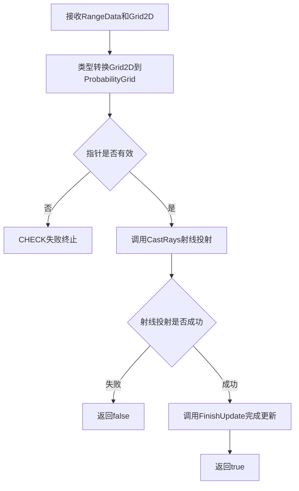
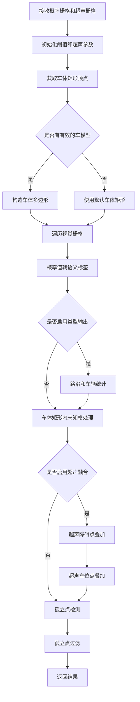

## 1 视觉栅格点获取与写入地图逻辑

## 1.1 概览
- 视觉点主要来自 `FreespaceFrame::ground_points`，必要时由轮廓生成。
- 点分类入口为 `GridMapHandle::AddPtsToGrid`，写入 `RangeData` 的 returns/misses。
- 写图使用 `GridMap2D::InsertRangeData` 与 `ProbabilityGridRangeDataInserter2D::Insert`。
- 输出前 `Grid2ProtoOut` 调用 `BinaryGrid` 将概率栅格离散化为语义栅格。

## 1.2 数据流与模块关系
- 视觉点与超声点共享同一栅格更新链路。



## 1.3 坐标系与单位
- 图像像素通过 `ImageXY2Body` 转为车身坐标，z 固定为 0。
- 车身坐标通过 `Rigid3f` 变换到地图坐标写入栅格。
- 栅格索引由 `MapLimits` 与 `resolution` 计算，单位 m。
- 相机原点为 `transform.translation + camera_positions_`。

## 1.4 关键类型与分类编码

| 字段 | 数值 | 用途 |
|---|---|---|
| `PERCEP_ROAD_TYPE` | 0 | 路面点，写入 miss |
| `PERCEP_CAR_TYPE` | 1 | 车辆点，写入 return |
| `PERCEP_CURB_TYPE` | 4 | 路沿点，写入 return |
| `PERCEP_VIRTUAL_MISS_TYPE` | 100 | 虚拟 miss 点 |
| `ULTRA_CAR_TYPE` | 9 | 超声修正后的车辆点 |
| `FREESPACE_*` | 0~7 | BinaryGrid 输出语义 |

## 1.5 关键函数速览

| 函数 | 位置 | 作用 |
|---|---|---|
| `GridMapHandle::AddFrame` | `src/core/mapping/grid/grid_map_handle.cc` | 视觉帧入口与调度 |
| `GridMapHandle::Contour2FreeSpace` | `src/core/mapping/grid/grid_map_handle.cc` | 视觉点转 RangeData 并写入 |
| `GridMapHandle::AddPtsToGrid` | `src/core/mapping/grid/grid_map_handle.cc` | 点分类到 returns/misses |
| `ProbabilityGridRangeDataInserter2D::Insert` | `src/core/mapping/grid/probability_grid_range_data_inserter_2d.cc` | 射线更新栅格 |
| `GridMapHandle::BinaryGrid` | `src/core/mapping/grid/grid_map_handle.cc` | 概率栅格离散化 |

## 1.6 处理流程概览
- `AddFrame` 组织姿态与超声帧并进入视觉写图。
- `Contour2FreeSpace` 生成 `RangeData` 并调用 `InsertRangeData`。
- `AddPtsToGrid` 负责类型到 returns/misses 的映射。
- `ProbabilityGridRangeDataInserter2D::Insert` 将 returns/misses 融入概率栅格。
- `BinaryGrid` 输出语义栅格并做超声融合。

## 1.7 重点函数逐行解释

### 1.7.1 GridMapHandle::AddFrame

**功能描述**：
视觉建图的主入口函数。接收每一帧的地面点云数据、车辆位姿和时间戳，负责协调整个视觉建图流程。主要功能包括：查找时间戳匹配的超声帧，构造车身到地图的刚体变换矩阵，调用Contour2FreeSpace处理视觉点云并写入栅格，进行性能监控并在启用可视化时绘制栅格地图。

**处理流程**：


#### 代码实现

```cpp
void GridMapHandle::AddFrame(
    std::vector<std::vector<cv::Point3f>>& ground_points,
    const Eigen::Vector3d& pose, const Eigen::Quaterniond& rot,
    const double& timestamp) {
  auto start_t = std::chrono::system_clock::now();  // 记录开始时间用于性能监控
  // AINFO <<__func__<< ", freespace frame info:: timestamp & pose:
  // "<<std::setprecision(18)<<timestamp <<" & "<<pose.transpose()<<";";
  auto ultra_frame = FindCorrespondUltra(timestamp);  // 按时间戳查找最近的超声帧数据
  Eigen::Quaternionf crot = rot.cast<float>();  // 将姿态四元数从double转换为float类型
  // crot.x() = crot.y() = 0;
  mapping::transform::Rigid3f transform(Eigen::Vector3f(pose.x(), pose.y(), 0),
                                        crot);  // 构造车身到地图的刚体变换（z=0表示2D投影）
  std::vector<std::vector<cv::Point3f>> addtional_pts;  // 存储额外生成的点云（轮廓模式）
  addtional_pts.resize(ground_points.size());  // 调整容器大小以匹配相机数量
  if (use_contours_) {  // 检查是否启用轮廓模式
    if (!Contour2FreeSpace(ground_points, addtional_pts, transform, grid_map_, timestamp,
                           ultra_frame)){  // 调用核心处理函数，转换点云并写入栅格
      AINFO << __func__ << std::fixed << " grid limits > 800 and reset, car_t = " << car_t_[0] << ", " << car_t_[1]
            << " frame = " << timestamp << " frame_t = " << pose[0] << ", " << pose[1];  // 地图过大，记录重置日志
      reset_flag_ = true;  // 设置重置标志
      return;  // 提前返回，不再处理该帧
    }
  }


  // 以下的调试代码
  static int show_type = (int)utility::ConfigLoad::Instance()  // 从配置加载调试可视化类型
                             ->Parser()
                             ->ipm_cam_param_.show_grid_type;
  if (out_grid_type_)  // 检查是否输出特定类型的栅格
    GetOnetypeObstacleGrid(ground_points, addtional_pts, transform, show_type);  // 获取指定类型的障碍物栅格

  auto dt = utility::common::GetCpuRunTimeSec(start_t);  // 计算处理耗时
  if (dt > 0.05) AINFO << __FUNCTION__ << " run time: " << dt;  // 若超过50ms则记录性能警告
  timestamp_ = timestamp;  // 保存当前帧的时间戳
  //    std::cerr<< " **free time**
  //    "<<utility::common::GetCpuRunTimeSec(start_t) <<std::endl;
  if (utility::ConfigLoad::Instance()->Parser()->env_param_.show_perception) {  // 检查是否启用感知可视化
    GridMapVisual(grid_map_[0]->grid(), pose.x(), pose.y());  // 绘制栅格地图及当前车位
  }
}
```

### 1.7.2 GridMapHandle::Contour2FreeSpace

**功能描述**：
视觉建图的核心处理函数。负责将视觉点云转换为栅格可用的RangeData格式并写入地图。主要功能包括：首帧初始化时清理车身周边的未知格点，恢复虚拟miss点的原始类型，可选地进行超声修正，遍历每路相机的点云进行分类（returns/misses），计算相机原点和坐标变换，最终调用InsertRangeData写入栅格。

**处理流程**：


#### 代码实现

```cpp
bool GridMapHandle::Contour2FreeSpace(
    std::vector<std::vector<cv::Point3f>>& ground_points,
    std::vector<std::vector<cv::Point3f>>& addtional_pts,
    const mapping::transform::Rigid3f& transform,
    std::vector<std::shared_ptr<mapping::GridMap2D>> grids, double timestamp,
    std::shared_ptr<mapping::UltrasonicData> ultra_frame) {

  // 地图还没有被更新过（刚创建）， 在第一帧数据到来时，清除车身周边点
  if( frame_updated_ == false && has_camera_position_){  // 首帧初始化检查
    mapping::sensor::RangeData rd;  // 创建RangeData用于首帧清理
    for (auto p : car_edge_pts_) {  // 遍历车身边缘预定义点
      mapping::sensor::RangefinderPoint tmp_point;
      tmp_point.position =
          Eigen::Vector3f(p.x, p.y, 0);  // 将车身边缘点设为miss点
      rd.misses.push_back(tmp_point);  // 添加到misses队列
    }

    Eigen::Quaternionf crot = car_rot_.cast<float>();  // 转换车身姿态为float
    Eigen::Vector3f t=car_t_.cast<float>();  // 转换车身位置为float
    mapping::transform::Rigid3f transform(t,crot);  // 构造车身到地图的变换
    rd.origin = transform.translation().cast<float>();  // 设置射线原点为车身位置
    rd.misses = mapping::sensor::TransformPointCloud(rd.misses, transform);  // 将miss点变换到地图坐标

    // std::unique_lock<std::mutex> munique(proto_lock_); // 此函数内千万不能加锁， 外部有锁， 内部锁会导致死锁
    auto& grid_map = grid_map_[0];  // 获取栅格地图引用
    if(!grid_map->InsertRangeData(rd)){  // 写入RangeData清理车身周边
      AINFO << "Init grid Insert ground point Fail!";  // 首帧清理失败日志
    }
    AINFO <<"Grid2d init cam position ,delete unkown cell arround car";  // 首帧清理完成日志
  }


  for (unsigned int i = 0; i < ground_points.size(); ++i){  // 遍历所有相机的点云
    for (auto& p : ground_points[i]) {  // 遍历当前相机的所有点
      if (p.z == PERCEP_VIRTUAL_MISS_TYPE){  // 检查是否为虚拟miss点
        p.z = PERCEP_ROAD_TYPE;  // 恢复为路面类型，准备正式处理
      }
    }
  }

  // 第二次投射
  if (use_ultra_ && car_status_ == mapping::CarStatus::LOOKING) {  // 检查是否启用超声修正且处于寻库状态
    CorrectionEdgeWithUltra(ground_points, addtional_pts, ultra_frame, timestamp);  // 用超声数据修正视觉点云边缘
  }


  // 第二次投射，处理除 虚拟 miss 点意外的点
  for (unsigned int i = 0; i < ground_points.size(); ++i) {  // 遍历所有相机
    mapping::sensor::RangeData rd;  // 为当前相机创建RangeData
    for (auto p : ground_points[i]) {  // 遍历当前相机的所有点
      //虚拟miss点在之前处理过, 超声车辆点，不处理,
      if (p.z == ULTRA_CAR_TYPE)  // 跳过超声修正后的车辆点
        continue;

      bool is_rear = i == 1? true:false;  // 判断是否为后相机（索引1）
      AddPtsToGrid(p, rd, is_rear);  // 调用点分类函数，将点加入returns或misses
    }
    if (addtional_pts.size() == ground_points.size()) {  // 检查附加点云容器是否有效
      for (auto p : addtional_pts[i]) {  // 遍历当前相机的附加点（轮廓生成）
        bool is_rear = i == 1? true:false;  // 判断是否为后相机
        AddPtsToGrid(p, rd, is_rear);  // 同样进行分类
      }
    } else {
      AINFO <<__func__<<", addtional_pts size is not correct. "<<addtional_pts.size();  // 附加点云尺寸错误日志
    }

    Eigen::Vector3f camera_pos = transform.rotation() * camera_positions_[i];  // 旋转相机在车身坐标系中的位置
    rd.origin = transform.translation().cast<float>() + camera_pos;  // 射线原点 = 车身在地图中的位置 + 相机偏移
    rd.returns = mapping::sensor::TransformPointCloud(rd.returns, transform);  // 将障碍点变换到地图坐标
    rd.misses = mapping::sensor::TransformPointCloud(rd.misses, transform);  // 将自由空间点变换到地图坐标
    auto& grid_map = grids[0];  // 获取栅格地图引用
    if(!grid_map->InsertRangeData(rd)){  // 将RangeData写入栅格
      AINFO << "Insert ground point Fail!";  // 写入失败日志
      return false;  // 返回失败
    }

  }
  frame_updated_ = true ;  // 标记首帧已更新，下次不再执行首帧清理
  return true;  // 返回成功
}
```
### 1.7.3 GridMapHandle::AddPtsToGrid

**功能描述**：
单点分类函数。根据点的z值编码判断点的类型属性，并将点添加到RangeData的returns（障碍物）或misses（自由空间）队列中。主要逻辑包括：虚拟miss点直接作为自由空间，非路面点（车辆、路沿等）一般作为障碍物，后相机的边缘静态障碍物（如路锥、路桩）会特殊处理为自由空间以避免误阻挡，路面点统一作为自由空间。

**处理流程**：


#### 代码实现

```cpp
bool GridMapHandle::AddPtsToGrid(cv::Point3f& p, mapping::sensor::RangeData& rd, bool is_rear) {
  mapping::sensor::RangefinderPoint tmp_point;  // 创建栅格点

  if( p.z == PERCEP_VIRTUAL_MISS_TYPE){  // 虚拟miss点（之前处理过的点）
    tmp_point.position =
        ImageXY2Body(p.x, p.y);  // 将像素坐标转换为车身坐标系（归一化坐标）
    rd.misses.push_back(tmp_point);  // 添加到自由空间队列
    return true;  // 提前返回
  }

  if (p.z != PERCEP_ROAD_TYPE ) {  // 非路面点（车辆、路沿、路锥等障碍物）
    // 非马路
    tmp_point.position =
        ImageXY2Body(p.x, p.y);  // 将像素坐标转换为车身坐标系

    // 后相机 点 类型为桶、墙、柱子等静态障碍物，且 不在车里中间（不挡车）
    // 添加为 miss 点
    if (is_rear && p.z >= CONE_BARREL_TYPE && (p.x < 0.32 || p.x > 0.68)) {  // 后相机边缘的静态障碍物（路锥、路桩），不在车中间区域
      rd.misses.push_back(tmp_point);  // 作为自由空间，避免误阻挡泊车路径
    } else{
      rd.returns.push_back(tmp_point);  // 其他非路面点作为障碍物
    }
  }else {
    // 马路点，统一 用miss点
    tmp_point.position =
        ImageXY2Body(p.x, p.y);  // 将像素坐标转换为车身坐标系
    rd.misses.push_back(tmp_point);  // 路面点作为自由空间
  }
  return true;  // 返回成功
}
```

### 1.7.4 ProbabilityGridRangeDataInserter2D::Insert

**功能描述**：
栅格更新的底层实现函数。将RangeData中的returns（障碍物）和misses（自由空间）点通过射线投射算法写入概率栅格。该函数是栅格地图更新的核心，通过调用CastRays进行射线追踪，根据hits和misses更新栅格的占据概率，并确保hits（障碍物）具有更高的优先级，避免被同cell的miss覆盖。

**处理流程**：


#### 代码实现

```cpp
bool ProbabilityGridRangeDataInserter2D::Insert(
    const sensor::RangeData& range_data, Grid2D* const grid) const {
  ProbabilityGrid* const probability_grid = static_cast<ProbabilityGrid*>(grid);  // 将基类Grid2D指针转换为ProbabilityGrid子类指针
  CHECK(probability_grid != nullptr);  // 检查指针有效性，无效则终止程序
  // By not finishing the update after hits are inserted, we give hits priority
  // (i.e. no hits will be ignored because of a miss in the same cell).
  if(!CastRays(range_data, hit_table_, miss_table_, update_free_space_, probability_grid)) return false;  // 执行射线投射更新栅格概率值，hits优先级高于misses
  probability_grid->FinishUpdate();  // 完成本轮更新，应用所有累积的概率变化
  return true;  // 返回成功
}
```

### 1.7.5 GridMapHandle::BinaryGrid

**功能描述**：
概率栅格的离散化和语义转换函数。将概率栅格中的连续概率值转换为离散的语义标签（障碍、自由、未知），并融合超声数据增强栅格语义。主要功能包括：初始化概率阈值和超声参数，遍历栅格将概率值映射为语义标签，根据路沿和车辆统计特征细化语义，处理车体矩形内的未知格点，融合超声障碍点和车位点，通过孤立点检测和过滤去除噪声。

**处理流程**：


#### 代码实现

```cpp
void GridMapHandle::BinaryGrid(mapping::proto::Grid2D& pgrid,
                               const mapping::proto::Grid2D& ultra_grid_out,
                               const std::vector<cv::Point3d>& rect,
                               std::vector<cv::Point3d>& debug_pts,
                               const bool& free_flag, const bool add_ultra) {
  // only used for original freespace image
  static int limit_free = 32767 * 0.35;  // 原始自由空间图像的障碍判定阈值（概率<35%为障碍）
  // only used for contours image
  static int limit_obt = 32767 * 0.4;  // 轮廓模式的障碍判定阈值（概率<40%为障碍）
  // static int limit_max = 32767*0.9;

  //超声波数据
  int avg_hit = ultra_car_pts_cnt_ == 0  // 如果无超声车辆点
                    ? 20  // 默认值为20
                    : ultra_car_pts_hits_ / ultra_car_pts_cnt_ * 10;  // 否则计算平均hit数
  // std::cerr <<__func__<<", ultra_car_pts_hits_: "<<ultra_car_pts_hits_<<",
  // ultra_car_pts_cnt_: "<<ultra_car_pts_cnt_<<std::endl;
  avg_hit = avg_hit >= 20 ? avg_hit+10 : 20;  // 确保avg_hit至少为20
  auto cells = pgrid.mutable_cells();  // 获取可修改的栅格单元指针
  size_t count = 0;  // 统计未知格数量
  auto box = pgrid.known_cells_box();  // 获取已知格的边界框
  int nx = pgrid.limits().cell_limits().num_x_cells();  // 获取栅格x方向单元数
  auto resolution = pgrid.limits().resolution();  // 获取栅格分辨率
  double mx = pgrid.limits().max().x(), my = pgrid.limits().max().y();  // 获取栅格坐标最大值

  std::vector<Eigen::Vector2d> rect_in_grid(0);  // 车体矩形的四个顶点
  Eigen::Vector2d p_grid1(4.15847, 1.17302);  // 默认车前右顶点
  Eigen::Vector2d p_grid2(4.15847, -1.14976);  // 默认车前左顶点
  Eigen::Vector2d p_grid3(-1.10, -1.14976);  // 默认车后左顶点
  Eigen::Vector2d p_grid4(-1.10, 1.17302);  // 默认车后右顶点
#ifdef CAR_JIANGLING_CX835
  if (car_positions_.size() >= 4) {  // 检查车模型是否有4个顶点
    for (int  i = 0; i < 4; i++ ) {  // 遍历车模型顶点
      auto p = car_positions_[i];
      Eigen::Vector3d p_grid(p.x(), p.y(), 0);  // 获取车体顶点在车身坐标系中的位置
      //auto p_world = car_rot_ * p_grid + car_t_;
      rect_in_grid.push_back(Eigen::Vector2d(p_grid[0],p_grid[1]));  // 添加顶点到矩形容器
      AINFO << __func__ << " car model corners: " << p_grid;
    }
  } else {
    AINFO << __func__ << "car positions size error: " << car_positions_.size();  // 车模型大小错误日志
    rect_in_grid.push_back(p_grid1);  // 使用默认矩形
    rect_in_grid.push_back(p_grid2);
    rect_in_grid.push_back(p_grid3);
    rect_in_grid.push_back(p_grid4);
  }
#else
  rect_in_grid.push_back(p_grid1);  // 使用默认矩形（非CX835车型）
  rect_in_grid.push_back(p_grid2);
  rect_in_grid.push_back(p_grid3);
  rect_in_grid.push_back(p_grid4);
#endif

    auto ultra_box = ultra_grid_out.known_cells_box();  // 获取超声栅格的边界框
    auto ultra_cells = &ultra_grid_out.cells();  // 获取超声栅格单元
    int ultra_nx = ultra_grid_out.limits().cell_limits().num_x_cells();  // 获取超声栅格x方向单元数
    auto ultra_resolution = ultra_grid_out.limits().resolution();  // 获取超声栅格分辨率
    double ultra_mx = ultra_grid_out.limits().max().x(),  // 超声栅格坐标最大值
           ultra_my = ultra_grid_out.limits().max().y();

    // 第一阶段：遍历视觉栅格，进行概率到语义的映射
    for (int row = box.min_x(); row <= box.max_x(); row++) {  // 遍历栅格行
      for (int col = box.min_y(); col <= box.max_y(); col++) {  // 遍历栅格列
        int i = nx * col + row;  // 计算线性索引
        auto& cell = cells->at(i);  // 获取栅格单元

        // 概率值转语义标签
        if (cell < limit_obt && cell != 0) {  // 如果概率值小于障碍阈值且不为0
          cell = FREESPACE_OBSTACLE;  // 设为障碍语义
        } else if (cell == 0) {  // 如果概率值为0
          cell = FREESPACE_UNKOWN;  // 设为未知语义
        } else {  // 否则
          cell = FREESPACE_FEREESPACE;  // 设为自由空间语义
        }

        if (!cell) count++;  // 统计未知格数量
        // 路沿和车辆特征细化
        if (out_grid_type_ && col < grid_curb_.rows && row < grid_curb_.cols) {  // 检查是否启用类型输出且坐标有效
          int tcell1 = grid_curb_.at<cv::Vec3b>(col, row)[0];  // 获取路沿统计数据
          if (tcell1 >= 1 && cell == FREESPACE_OBSTACLE) cell = FREESPACE_CURB;  // 路沿判定
          int tcell2 = grid_curb_.at<cv::Vec3b>(col, row)[1];  // 获取车辆统计数据
          if (tcell2 >= 5 && cell == FREESPACE_OBSTACLE) cell = FREESPACE_CAR;  // 车辆判定
        }

        // 车体矩形内未知格处理：将车内的未知格设为自由空间
        if (cell == FREESPACE_UNKOWN && rect_in_grid.size() == 4) {  // 如果是未知格且有有效车体矩形
          double x = mx - col * resolution;  // 计算地图坐标
          double y = my - row * resolution;

          Eigen::Vector3d pos_w;
          pos_w << x, y, 0;
          Eigen::Vector3d pos_car =
              car_rot_.inverse() * pos_w - car_rot_.inverse() * car_t_;  // 转换为车身坐标
          Eigen::Vector2d p(pos_car.x(), pos_car.y());  // 获取2D点
          if (Utility::IsPtInPolygon(p, rect_in_grid)) {  // 检查点是否在车体矩形内
            cell = FREESPACE_FEREESPACE;  // 设为自由空间
          }
        }
      }
    }

    // 第二阶段：超声融合（可选）
    if (add_ultra) {  // 如果启用超声融合
      for (int row = ultra_box.min_x(); row <= ultra_box.max_x(); row++) {  // 遍历超声栅格
        for (int col = ultra_box.min_y(); col <= ultra_box.max_y(); col++) {
          int i = ultra_nx * col + row;  // 计算超声栅格线性索引
          if (i >= ultra_cells->size()) continue;  // 边界检查
          auto& cell = ultra_cells->at(i);  // 获取超声单元
          if (cell != FREESPACE_UNKOWN) {  // 如果不是未知格
            int h = i / ultra_nx;  // 计算行号
            int w = i % ultra_nx;  // 计算列号
            double x = ultra_mx - h * ultra_resolution;  // 计算地图坐标
            double y = ultra_my - w * ultra_resolution;
            Eigen::Vector3d pos_w;
            pos_w << x, y, 0;
            Eigen::Vector3d pos_car =
                car_rot_.inverse() * pos_w - car_rot_.inverse() * car_t_;  // 转换为车身坐标
            if (pos_car[0] < 7 && pos_car[0] > -8 && pos_car[1] < 6 &&
                pos_car[1] > -6) {  // 检查是否在有效融合范围内
              int ultra_h = (mx - x) / resolution;  // 计算视觉栅格坐标
              int ultra_w = (my - y) / resolution;
              if (ultra_w > pgrid.known_cells_box().min_x() + 1 &&  // 边界检查
                  ultra_w < pgrid.known_cells_box().max_x() - 1 &&
                  ultra_h > pgrid.known_cells_box().min_y() + 1 &&
                  ultra_h < pgrid.known_cells_box().max_y() - 1) {
                int percep_i = ultra_h * nx + ultra_w;  // 计算视觉栅格索引
                if (percep_i < cells->size()) {  // 边界检查
                  auto& percep_cell = cells->at(percep_i);  // 获取视觉栅格单元
                  if (cell == FREESPACE_OBSTACLE) percep_cell = FREESPACE_ULTRA;  // 超声障碍点叠加
                }
              }
            }
          }
        }
      }
    }

    // 第三阶段：孤立点检测与过滤
    std::vector<int> single_p_index;  // 存储孤立点的索引
    single_p_index.clear();
    obstacle_points_.clear();  // 清空调试点云
    for (int row = box.min_x(); row <= box.max_x(); row++) {  // 遍历栅格
      for (int col = box.min_y(); col <= box.max_y(); col++) {
        int i = nx * col + row;  // 计算线性索引
        auto& cell = cells->at(i);  // 获取栅格单元

        // 检查超声车位点是否孤立
        if (cell == FREESPACE_ULTRA_CAR) {  // 如果是超声车位
          bool single = true;  // 假设初始为孤立
          for (int neighbor_delta_col = -6; neighbor_delta_col <= 6;
               neighbor_delta_col++) {  // 检查周围邻域（±6格）
            if (!single) break;
            for (int neighbor_delta_row = -6; neighbor_delta_row <= 6;
                 neighbor_delta_row = neighbor_delta_row + 2) {
              int neighbor_col = col + neighbor_delta_col;  // 邻域列坐标
              int neighbor_row = row + neighbor_delta_row;  // 邻域行坐标
              int neighbor_index = nx * neighbor_col + neighbor_row;  // 邻域索引
              if (neighbor_index < cells->size() && neighbor_index > 0 &&
                  (cells->at(neighbor_index) != FREESPACE_FEREESPACE &&
                   cells->at(neighbor_index) != FREESPACE_ULTRA_CAR)) {  // 如果邻域有其他类型单元
                single = false;  // 不是孤立点
            }
          }
        }

        if (single) {  // 如果是孤立的超声车位
          single_p_index.push_back(i);  // 添加到孤立点列表
        }
      }

      // 检查障碍点是否孤立
      if (cell != FREESPACE_FEREESPACE && cell != FREESPACE_ULTRA_CAR) {  // 如果是障碍或未知
        int neighbor = 0;  // 自由空间邻域计数
        // 检查8邻域的自由空间单元数
        int neighbor_col = col;
        int neighbor_row = row + 1;
        int neighbor_index = nx * neighbor_col + neighbor_row;
        if (neighbor_index < cells->size() && neighbor_index > 0 &&
            cells->at(neighbor_index) == FREESPACE_FEREESPACE)
          neighbor++;
        neighbor_col = col;
        neighbor_row = row - 1;
        neighbor_index = nx * neighbor_col + neighbor_row;
        if (neighbor_index < cells->size() && neighbor_index > 0 &&
            cells->at(neighbor_index) == FREESPACE_FEREESPACE)
          neighbor++;
        neighbor_col = col + 1;
        neighbor_row = row - 1;
        neighbor_index = nx * neighbor_col + neighbor_row;
        if (neighbor_index < cells->size() && neighbor_index > 0 &&
            cells->at(neighbor_index) == FREESPACE_FEREESPACE)
          neighbor++;
        neighbor_col = col + 1;
        neighbor_row = row;
        neighbor_index = nx * neighbor_col + neighbor_row;
        if (neighbor_index < cells->size() && neighbor_index > 0 &&
            cells->at(neighbor_index) == FREESPACE_FEREESPACE)
          neighbor++;
        neighbor_col = col + 1;
        neighbor_row = row + 1;
        neighbor_index = nx * neighbor_col + neighbor_row;
        if (neighbor_index < cells->size() && neighbor_index > 0 &&
            cells->at(neighbor_index) == FREESPACE_FEREESPACE)
          neighbor++;
        neighbor_col = col - 1;
        neighbor_row = row + 1;
        neighbor_index = nx * neighbor_col + neighbor_row;
        if (neighbor_index < cells->size() && neighbor_index > 0 &&
            cells->at(neighbor_index) == FREESPACE_FEREESPACE)
          neighbor++;
        neighbor_col = col - 1;
        neighbor_row = row;
        neighbor_index = nx * neighbor_col + neighbor_row;
        if (neighbor_index < cells->size() && neighbor_index > 0 &&
            cells->at(neighbor_index) == FREESPACE_FEREESPACE)
          neighbor++;
        neighbor_col = col - 1;
        neighbor_row = row - 1;
        neighbor_index = nx * neighbor_col + neighbor_row;
        if (neighbor_index < cells->size() && neighbor_index > 0 &&
            cells->at(neighbor_index) == FREESPACE_FEREESPACE)
          neighbor++;

        // 如果自由空间邻域数小于阈值，标记为孤立点
        if (neighbor >= utility::ConfigLoad::Instance()
                            ->Parser()
                            ->ipm_cam_param_.freespace_neighbor_count_filter) {  // 自由空间邻域数超过阈值
          single_p_index.push_back(i);  // 不是孤立点，添加到过滤列表
        } else {
          //save debug message, do not necessary
          int h = i / nx;  // 计算行号
          int w = i % nx;  // 计算列号
          double x = mx - h * resolution;  // 计算地图坐标
          double y = my - w * resolution;
          Eigen::Vector3d pos_w;
          pos_w << x, y, 0;
          Eigen::Vector3d pos_car =
              car_rot_.inverse() * pos_w - car_rot_.inverse() * car_t_;  // 转换为车身坐标
          if (pos_car[0] < 6 && pos_car[0] > -3 && pos_car[1] < 3 &&
              pos_car[1] > -3){  // 检查是否在车周围范围内
                cv::Point3d p;
                p.x = x;
                p.y = y;
                p.z = (double)cell;
                debug_pts.push_back(p);  // 保存调试点
                obstacle_points_.push_back(p);  // 保存障碍点
              }
        }
      }
    }

  // 第四阶段：过滤孤立点
  for (auto index : single_p_index) {  // 遍历孤立点列表
    auto& cell = cells->at(index);  // 获取单元
    if (index < cells->size() && index > 0) cell = FREESPACE_FEREESPACE;  // 将孤立点设为自由空间
  }

  // 第五阶段：添加超声车位点
  bool add_utlraslot = true;  // 是否添加超声车位点
  if (add_utlraslot){  // 如果启用
    for (auto p : added_ultraslot_grid_) {  // 遍历超声车位点
      int ultra_h = (mx - p.x) / resolution;  // 计算视觉栅格坐标
      int ultra_w = (my - p.y) / resolution;
      if (ultra_w > pgrid.known_cells_box().min_x() + 1 &&  // 边界检查
                ultra_w < pgrid.known_cells_box().max_x() - 1 &&
                ultra_h > pgrid.known_cells_box().min_y() + 1 &&
                ultra_h < pgrid.known_cells_box().max_y() - 1) {
        int percep_i = ultra_h * nx + ultra_w;  // 计算视觉栅格索引
        if (percep_i < cells->size()) {  // 边界检查
          auto& percep_cell = cells->at(percep_i);  // 获取视觉栅格单元
          percep_cell = FREESPACE_ULTRA_CAR;  // 设为超声车位语义
        }
      }
    }
  }

  // 第六阶段：添加超声障碍点
  static bool add_uss_obts = utility::ConfigLoad::Instance()  // 是否添加超声障碍点（从配置加载）
                                 ->Parser()
                                 ->env_param_.enable_send_ultra_obs_;
  if (add_uss_obts) {  // 如果启用
    for (auto p : added_ultra_obts_) {  // 遍历超声障碍点
      int ultra_h = (mx - p.x) / resolution;  // 计算视觉栅格坐标
      int ultra_w = (my - p.y) / resolution;
      if (ultra_w > pgrid.known_cells_box().min_x() + 1 &&  // 边界检查
                ultra_w < pgrid.known_cells_box().max_x() - 1 &&
                ultra_h > pgrid.known_cells_box().min_y() + 1 &&
                ultra_h < pgrid.known_cells_box().max_y() - 1) {
        int percep_i = ultra_h * nx + ultra_w;  // 计算视觉栅格索引
        if (percep_i < cells->size()) {  // 边界检查
          auto& percep_cell = cells->at(percep_i);  // 获取视觉栅格单元
          percep_cell = FREESPACE_ULTRA_OBTS;  // 设为超声障碍语义
        }
      }
    }
  }

  // AINFO << "zero cell num / total num: " << count << " / " << cells->size();
}
```

## 1.8 关键参数与阈值

| 参数 | 来源 | 含义 |
|---|---|---|
| `use_freespace_contours` | 配置 | 决定是否走轮廓模式 |
| `skip_step` | 配置 | 图像采样步长 |
| `limit_obt=0.4*32767` | 常量 | 障碍判定阈值 |
| `freespace_neighbor_count_filter` | 配置 | 孤立障碍过滤阈值 |

## 1.9 边界条件与注意事项
- `has_camera_position_` 为 false 时不会清除车身周边未知格。
- `frame_updated_` 控制首帧清理逻辑，只执行一次。
- `use_contours_` 影响 `update_free_space` 的射线策略。
- `ULTRA_CAR_TYPE` 会在第二次投射中跳过更新。
- `ResizeGrid` 由行驶距离和地图尺寸触发裁剪。

## 1.10 参考与版本信息
- 视觉主逻辑：`src/core/mapping/grid/grid_map_handle.cc`
- 视觉接口：`src/core/mapping/grid/grid_map_handle.h`
- 栅格更新：`src/core/mapping/grid/grid_map_2d.cc`
- 射线更新：`src/core/mapping/grid/probability_grid_range_data_inserter_2d.cc`
