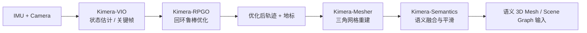
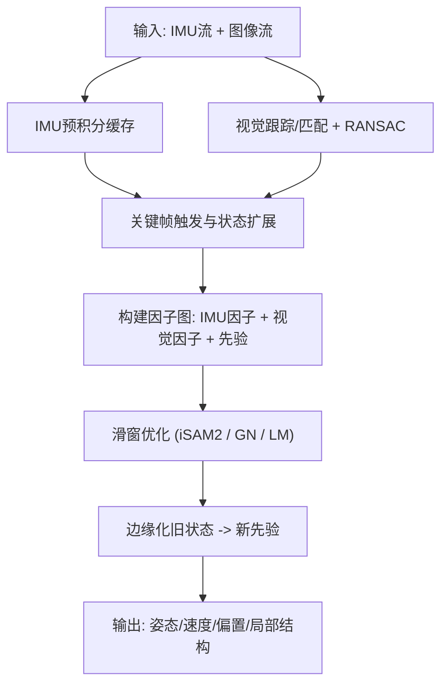
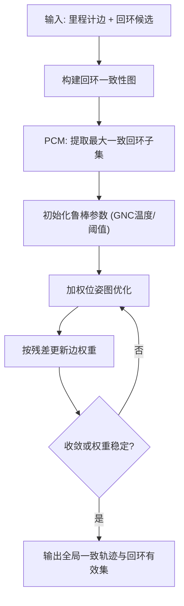
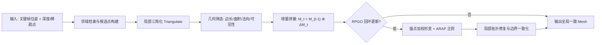
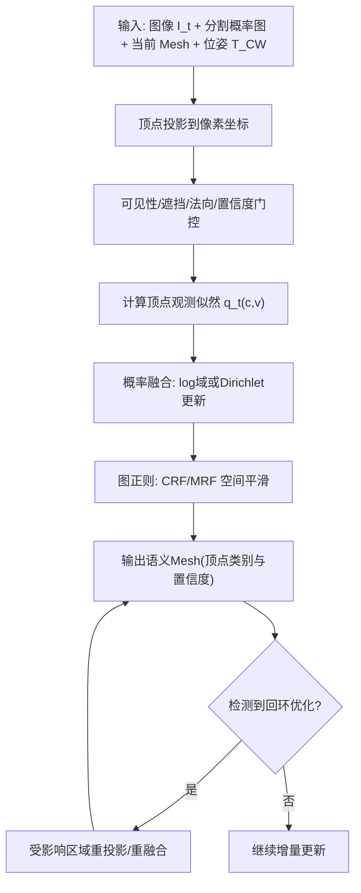
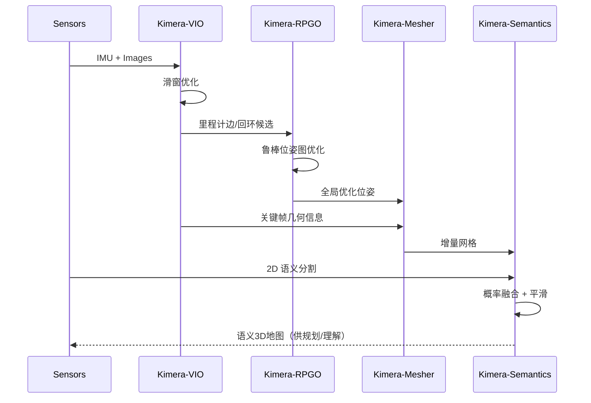

## 1. 总览

Kimera 可以理解为一条从“多传感器状态估计”到“可语义理解 3D 地图”的流水线：
- `Kimera-VIO`：实时估计相机/IMU 状态并输出关键帧与稀疏地图。
- `Kimera-RPGO`：在回环和错误约束存在时，做鲁棒位姿图优化。
- `Kimera-Mesher`：把稀疏几何与关键帧深度组织成连续网格。
- `Kimera-Semantics`：将语义标签融合到 3D 网格，生成可查询语义地图。

## 2. Kimera-VIO 原理

### 2.1 状态建模与因子图变量

Kimera-VIO 在滑窗内联合估计 IMU 状态、相机位姿和（显式或隐式）视觉结构。  
第 $k$ 帧状态可写为：

$$
\mathbf{x}_k = (\mathbf{R}_k,\mathbf{p}_k,\mathbf{v}_k,\mathbf{b}_k^g,\mathbf{b}_k^a)
$$

全局目标是最小化 IMU 约束、视觉约束和先验项：

$$
\min_{\mathbf{X}} \left( \sum_{k}\lVert \mathbf{r}_{imu,k} \rVert^2_{\mathbf{\Sigma}_{imu,k}^{-1}} + \sum_{(i,j)}\lVert \mathbf{r}_{cam,ij} \rVert^2_{\mathbf{\Sigma}_{cam,ij}^{-1}} + \lVert \mathbf{r}_{prior} \rVert^2_{\mathbf{\Sigma}_{prior}^{-1}} \right)
$$

其中视觉重投影残差为：

$$
\mathbf{r}_{cam,ij} = \mathbf{z}_{ij} - \pi(\mathbf{T}_{C_iW}\mathbf{P}_j)
$$

### 2.2 IMU 预积分约束（VIO 稳定性的核心）

IMU 高频数据不会全部作为变量进入优化，而是压缩为关键帧间预积分量：

$$
(\Delta \mathbf{R}_{ij},\Delta \mathbf{v}_{ij},\Delta \mathbf{p}_{ij}) = \operatorname{Preintegrate}(\omega_t,a_t,\hat{\mathbf{b}}_i^g,\hat{\mathbf{b}}_i^a)
$$

对应残差可抽象为：

$$
\mathbf{r}_{imu,ij} = \operatorname{Log}\!\left( \Delta \mathbf{T}_{ij}^{-1}\,\mathbf{T}_i^{-1}\mathbf{T}_j \right) \oplus \mathbf{r}_v \oplus \mathbf{r}_p \oplus \mathbf{r}_b
$$

意义：
- 用“预积分因子”替代海量 IMU 点，降低计算量。
- 同时估计偏置，抑制长时间漂移。
- 为视觉弱纹理或短时动态退化提供惯性支撑。

### 2.3 视觉前端与视觉因子

视觉侧负责提供可优化的几何约束，典型流程是：
- 金字塔光流或描述子匹配做跨帧跟踪。
- RANSAC 几何一致性过滤（剔除外点）。
- 关键帧策略控制图规模（视差、时间、跟踪质量触发）。

视觉约束进入因子图后，优化目标会与 IMU 共同约束姿态与尺度。  
如果使用 structureless 形式，可消除显式路标变量，进一步降低求解维度。

### 2.4 滑窗优化与边缘化

Kimera-VIO 采用固定窗口增量优化。窗口满时，旧状态被边缘化为先验：

$$
\mathbf{H}_{new} = \mathbf{H}_{keep,keep} - \mathbf{H}_{keep,marg}\mathbf{H}_{marg,marg}^{-1}\mathbf{H}_{marg,keep}
$$

这相当于 Schur Complement，把被删除变量的信息压缩到保留变量里。  
工程收益：
- 实时性可控（变量数近似常量）。
- 保持历史信息对当前估计的影响。

### 2.5 退化工况与鲁棒机制

VIO 常见退化来源：
- 纯旋转或低视差（视觉深度约束弱）。
- 强动态物体占比高（前端误匹配增加）。
- 高频振动或 IMU 偏置突变（惯性约束失真）。

常见缓解策略：
- 视觉残差鲁棒核（Huber/Cauchy）降低外点影响。
- 跟踪健康度监控，必要时重置关键帧或短时冻结更新。
- 用回环后端（RPGO）做全局纠偏，VIO 专注局部一致性。

### 2.6 深入版运行流程图

### 2.7 实现要点

- VIO 的本质是“惯性短时稳定 + 视觉长期约束”的互补。
- 预积分与边缘化决定了系统是否能在实时条件下稳定运行。
- 前端外点控制质量直接影响后端收敛与轨迹平滑性。

## 3. Kimera-RPGO 原理

### 3.1 问题建模：为什么需要鲁棒 PGO

回环约束一旦混入误匹配，普通 PGO 会把整条轨迹“拉歪”。  
RPGO 的目标是：在保留真回环的同时自动抑制离群边。

优化形式可写为：

$$
\min_{\{\mathbf{T}_i\}} \sum_{(i,j)\in\mathcal{E}} \rho\!\left( \left\lVert \log(\mathbf{Z}_{ij}^{-1}\mathbf{T}_i^{-1}\mathbf{T}_j) \right\rVert_{\mathbf{\Omega}_{ij}}^2 \right)
$$

其中：
- $\mathbf{Z}_{ij}$ 是观测相对位姿。
- $\mathbf{T}_i,\mathbf{T}_j$ 是待优化节点位姿。
- $\rho(\cdot)$ 是鲁棒损失（如 TLS/GNC 对应的有效形式）。

### 3.2 PCM：回环一致性前筛选

Pairwise Consistency Maximization (PCM) 的思想是：  
若两条回环边在同一子图中彼此矛盾，则至少有一条是假回环。

可抽象为对候选回环集合构造一致性图，再求最大一致子集：

$$
\mathcal{E}_{loop}^{*} = \arg\max_{\mathcal{S}\subseteq \mathcal{E}_{loop}} \operatorname{Consistent}(\mathcal{S})
$$

工程意义：
- 在进入非线性优化前先做“硬过滤”。
- 显著降低后续 GNC 的压力和误收敛概率。

### 3.3 GNC/TLS：连续退火的鲁棒加权

GNC 会从“近似凸”的加权目标逐步过渡到“强鲁棒”目标。  
可写成迭代重加权形式：

$$
\min_{\mathbf{T}} \sum_{(i,j)\in\mathcal{E}} w_{ij}^{(k)}\,\left\lVert \log(\mathbf{Z}_{ij}^{-1}\mathbf{T}_i^{-1}\mathbf{T}_j) \right\rVert_{\mathbf{\Omega}_{ij}}^2
$$

并在每轮按残差更新权重 $w_{ij}^{(k)}$。大残差边会被逐步降权到接近 0。  
直观上，这相当于“先让图能收敛，再逐渐把离群边踢出有效集合”。

### 3.4 增量求解与回环触发策略

RPGO 不必每帧全局重算，通常在回环事件触发时做增量更新：
- 新回环候选到来，先过 PCM。
- 若一致性通过，再进入 GNC 迭代。
- 当优化增益低于阈值或权重集合稳定时停止。

典型收敛判断可写为：

$$
\frac{E^{(k-1)}-E^{(k)}}{E^{(k-1)}} < \epsilon
$$

这样可避免无效迭代，控制全局优化时延。

### 3.5 深入版运行流程图

### 3.6 实现要点

- PCM 解决“明显错误回环”，GNC 解决“难分边界样本”，两者互补。
- 先筛选再优化，优于单纯在优化器里硬抗所有离群边。
- RPGO 输出不仅给轨迹，还会直接影响 Mesher 与 Semantics 的全局一致性。

## 4. Kimera-Mesher 原理

### 4.1 局部到全局网格

Kimera-Mesher 的目标是把 VIO/RPGO 提供的稀疏几何组织成连续可用的曲面。  
在时刻 $t$，网格状态可记为：

$$
\mathcal{M}_t = (\mathcal{V}_t,\mathcal{F}_t), \quad \mathcal{V}_t \subset \mathbb{R}^3, \quad \mathcal{F}_t \subset \mathcal{V}_t^3
$$

其中：
- $\mathcal{V}_t$：顶点集合（来自关键帧深度/三角化点）。
- $\mathcal{F}_t$：三角面集合（拓扑连接关系）。

Mesher 不是“每次全量重建”，而是增量更新：

$$
\mathcal{M}_t = \mathcal{M}_{t-1} \oplus \Delta \mathcal{M}_t
$$

即在已有网格上只插入/删除受影响区域，保证实时性。

### 4.2 增量三角化：候选边与候选面的生成

对新关键帧 $k$，先从其可见邻域提取点集 $\mathcal{P}_k$ 与邻接候选 $\mathcal{N}_k$，再做局部三角化：

$$
\Delta \mathcal{F}_k = \operatorname{Triangulate}(\mathcal{P}_k,\mathcal{N}_k)
$$

候选边/面的打分通常结合重投影误差和视差基线。可抽象为：

$$
s_{ij} = \exp\!\left(-\frac{e_{reproj,ij}^2}{\sigma_r^2}\right)\exp\!\left(-\frac{\max(0,\theta_{min}-\theta_{ij})^2}{\sigma_{\theta}^2}\right)
$$

含义：
- 重投影误差小，边更可靠。
- 视差角 $\theta_{ij}$ 太小（近共线）会被降权，避免退化三角形。

### 4.3 几何筛选：避免坏三角形和错误连接

局部三角化后，Mesher 会进行几何筛选，常见规则包括：
- 边长阈值：过滤过长边，避免跨物体表面“拉丝”。
- 面积阈值：过滤接近退化的小三角形。
- 法向一致性：大法向突变处减少连接，保护边界。
- 可见性一致性：与深度/遮挡冲突的面直接剔除。

三角面面积可写为：

$$
A_{\triangle(i,j,k)} = \frac{1}{2}\lVert(\mathbf{v}_j-\mathbf{v}_i)\times(\mathbf{v}_k-\mathbf{v}_i)\rVert_2
$$

只有满足几何约束的面才会加入全局网格，以保证稳定拓扑与可解释表面。

### 4.4 回环后的网格形变与一致化

RPGO 触发后，历史关键帧位姿会更新。如果只改轨迹不改网格，Mesh 会和新轨迹错位。  
因此 Mesher 需要做“几何重对齐”，常见做法是锚点加权形变：

$$
\mathbf{p}'_v = \sum_{m \in \mathcal{A}(v)} w_{vm}(\mathbf{R}_m\mathbf{p}_v+\mathbf{t}_m), \quad \sum_{m}w_{vm}=1
$$

进一步可加入局部刚性（ARAP）正则，抑制过度扭曲：

$$
E_{arap} = \sum_{(i,j)\in \mathcal{E}}\lVert(\mathbf{p}'_i-\mathbf{p}'_j)-\mathbf{R}_i(\mathbf{p}_i-\mathbf{p}_j)\rVert_2^2
$$

这一步保证“回环后轨迹一致”与“网格局部形状稳定”同时成立。

### 4.5 复杂度与工程参数

关键工程点：
- 增量窗口大小：窗口越大，几何完整性更好，但实时性下降。
- 边长阈值：过大易跨面误连，过小会破碎。
- 法向阈值：过严会断裂，过松会糊边界。
- 回环重构范围：全局重放最准确，局部修正更实时。

复杂度可近似理解为：
- 局部三角化：随局部点数增长，典型在关键帧邻域内可控。
- 回环形变：随受影响顶点数增长，通常采用子图更新而非全图重算。

### 4.6 深入版运行流程图

### 4.7 实现要点

- 通过几何筛选抑制细长三角形与跨面错误连接。
- 回环后必须做网格重对齐，否则会出现“轨迹正确、网格漂移”的不一致。
- 优先做局部子图更新，再按需触发全局重放，平衡精度与实时性。
- 输出可用于导航碰撞检查、场景可视化和语义附着。

## 5. Kimera-Semantics 原理

### 5.1 观测模型与 2D 到 3D 投影

Kimera-Semantics 的核心不是“给网格贴颜色”，而是把每帧 2D 分割概率图转成 **对 3D 顶点类别的概率观测**。  
对顶点 $v$（世界坐标 $\mathbf{p}_v^W$），在时刻 $t$ 的相机投影为：

$$
\tilde{\mathbf{u}}_{t,v} \sim \mathbf{K}\,\mathbf{T}_{CW,t}\,\mathbf{p}_v^W
$$

从分割网络输出 logits 或概率图后，得到该顶点的类别似然：

$$
q_t(c,v) = P(c \mid \mathbf{u}_{t,v}, I_t)
$$

但不是所有投影点都可直接融合，实际会做几何门控（visibility gating）：
- 视锥内检查（是否落在图像范围内）。
- 深度一致性检查（避免被前景遮挡时错误写入背景类）。
- 法向与视线夹角检查（大斜角观测降低权重）。
- 分割置信度阈值检查（低置信像素不更新）。

### 5.2 概率融合：从单帧噪声到稳定后验

给定顶点类别后验 $P_t(c \mid v)$，基础贝叶斯更新为：

$$
P_t(c \mid v) \propto P(\mathbf{z}_t \mid c,v)\,P_{t-1}(c \mid v)
$$

工程上常用两种等价但更稳的实现：

- 对数域累积（避免数值下溢）：

$$
\ell_t(c \mid v) = \ell_{t-1}(c \mid v) + w_t(v)\,\log q_t(c,v)
$$

- Dirichlet 计数累积（便于解释“观测票数”）：

$$
\alpha_t(c,v) = \alpha_{t-1}(c,v) + w_t(v)\,q_t(c,v), \quad P_t(c \mid v)=\frac{\alpha_t(c,v)}{\sum_{c'}\alpha_t(c',v)}
$$

其中权重 $w_t(v)$ 来自可见性、置信度和几何一致性：

$$
w_t(v)=\mathbf{1}_{vis}(v)\,\mathrm{conf}(\mathbf{u}_{t,v})\,\exp\!\left(-\frac{d_{geo}(t,v)^2}{\sigma_g^2}\right)
$$

这一步的意义是把“单帧分类抖动”转成“多帧统计稳定”。

### 5.3 空间一致性：网格图上的 CRF/MRF 正则

仅靠逐顶点独立更新，边界会有椒盐噪声。Kimera-Semantics 通常在网格邻接图上再做一次图优化：

$$
E(\mathbf{L}) = \sum_{v}\phi_v(L_v) + \lambda \sum_{(u,v)\in\mathcal{N}} \psi_{uv}(L_u,L_v)
$$

含义：
- Unary 项 $\phi_v$：来自融合后的负对数后验，鼓励保持观测支持的类别。
- Pairwise 项 $\psi_{uv}$：邻接顶点若几何相近（空间近、法向近），惩罚标签突变；若几何不连续（边缘/折角），降低惩罚保留边界。

典型 pairwise 形式：

$$
\psi_{uv}(L_u,L_v)=\mathbf{1}[L_u\neq L_v]\exp\!\left(-\frac{\lVert\mathbf{x}_u-\mathbf{x}_v\rVert^2}{\sigma_x^2}-\frac{\lVert\mathbf{n}_u-\mathbf{n}_v\rVert^2}{\sigma_n^2}\right)
$$

### 5.4 时序一致性与回环后的语义重对齐

Kimera 系统里，RPGO 可能在回环后显著调整历史位姿。若只更新几何不更新语义，会出现“语义贴图漂移”。  
因此语义模块需要配合后端做两类处理：
- 增量阶段：新关键帧到来即投影融合，保证在线可用。
- 回环阶段：当位姿图更新后，对受影响关键帧/顶点执行重投影或局部重融合，恢复几何与语义一致。

工程上常见两种策略：
- `重放融合`：保存历史观测，按新位姿重算（准确但耗时）。
- `局部修正`：只修正回环附近子图（实时性更好）。

### 5.5 深入版运行流程图

## 6. 四个模块对比表

| 模块 | 核心输入 | 核心输出 | 主要优化对象 | 典型作用 |
|---|---|---|---|---|
| Kimera-VIO | IMU + 图像特征 | 局部连续位姿、速度、偏置、地标 | 滑窗状态与地标 | 实时里程计与短时一致性 |
| Kimera-RPGO | 位姿图边（含回环） | 全局一致轨迹 | 位姿图节点位姿 | 抗错误回环、消除全局漂移 |
| Kimera-Mesher | 优化轨迹 + 几何点/深度 | 三角网格 | 网格顶点/面连接 | 生成可用 3D 几何表面 |
| Kimera-Semantics | 2D 语义 + 3D 网格 | 语义网格/场景语义 | 顶点类别后验 | 几何到语义的可解释建图 |

## 7. 端到端运行时序图

## 8. 工程落地建议

- 先保证 `VIO` 稳定，再接 `RPGO`，最后接 `Mesher/Semantics`，便于定位误差来源。
- 回环质量直接决定全局几何质量，RPGO 的阈值和核函数参数需要数据集标定。
- 语义融合建议使用“置信度门限 + 邻域平滑”，减少单帧分割噪声对地图污染。
